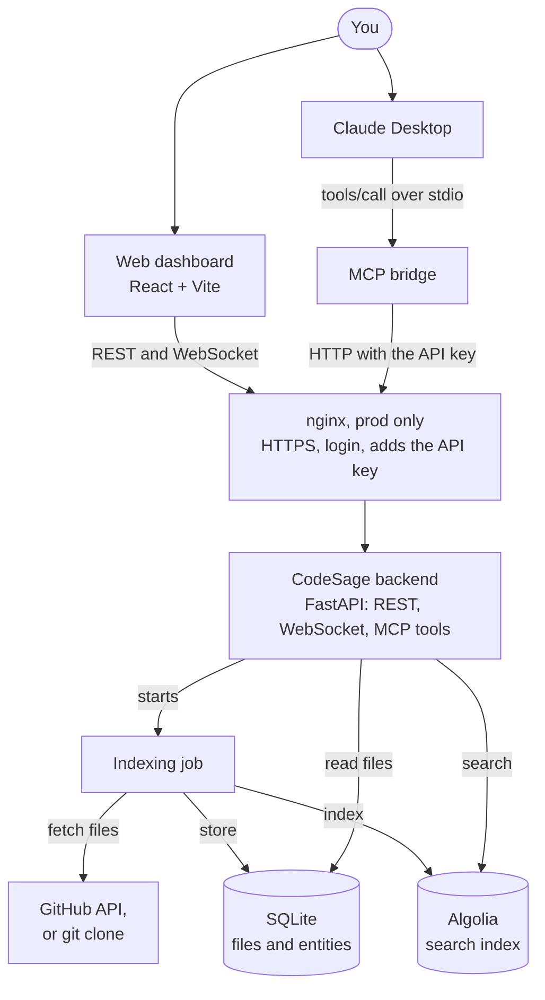
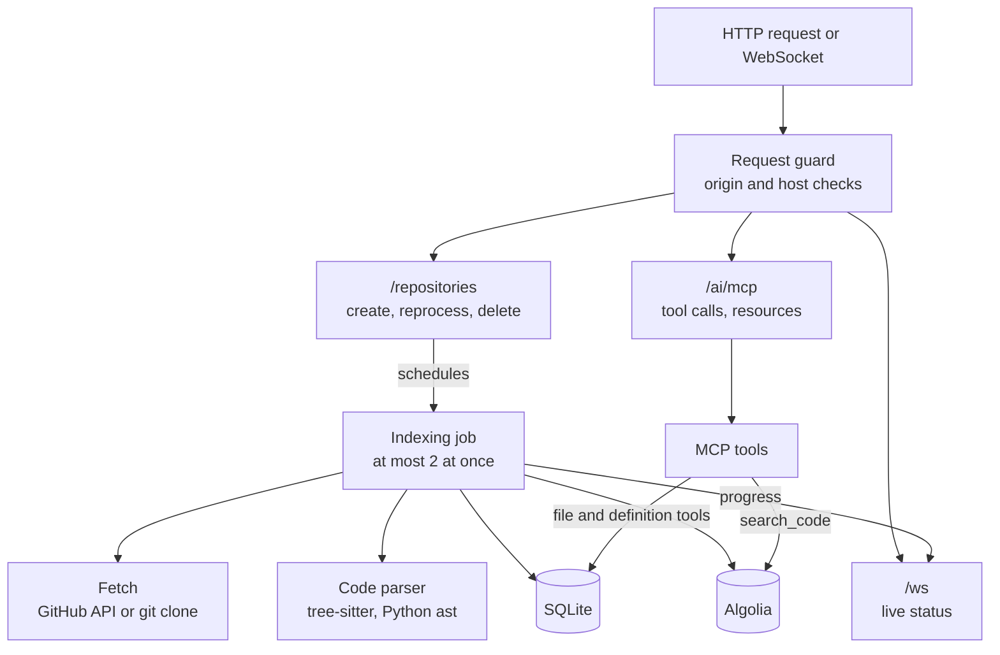
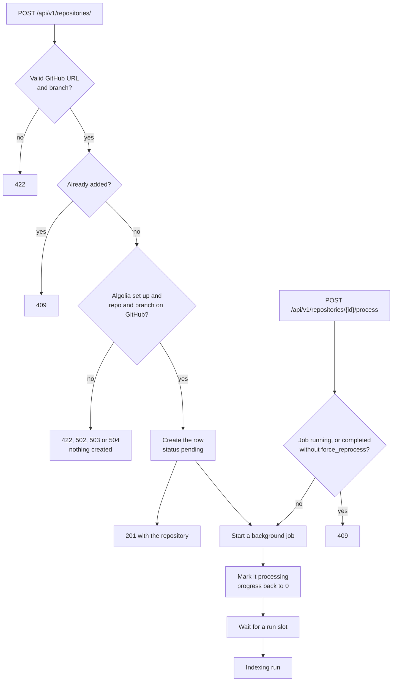
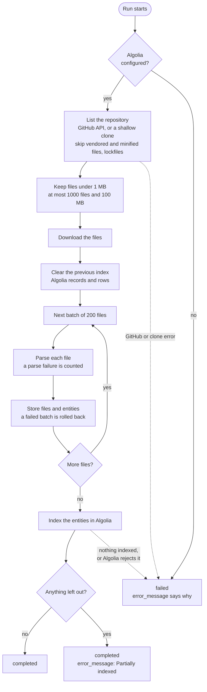
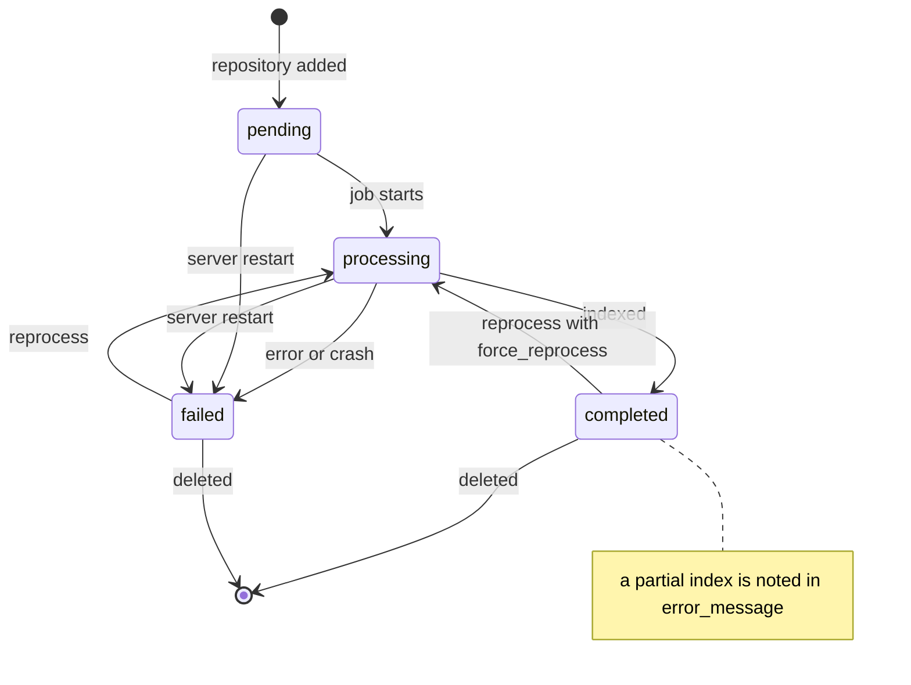
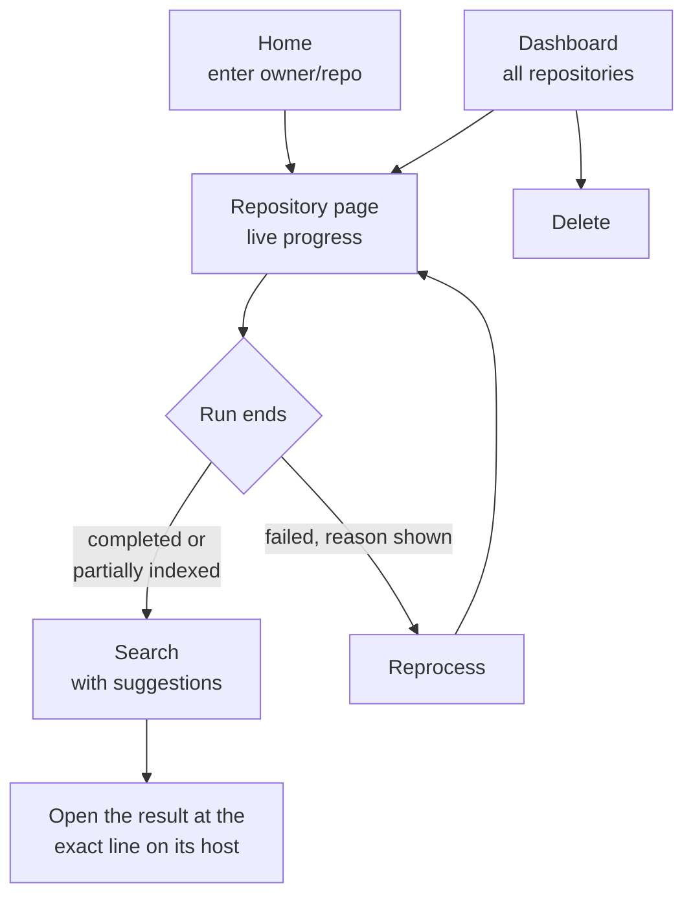
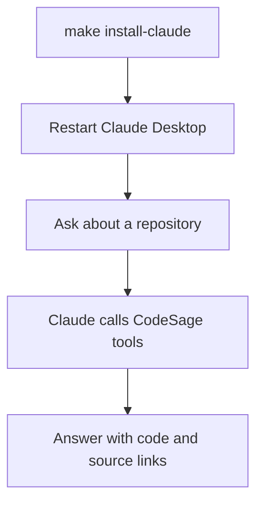
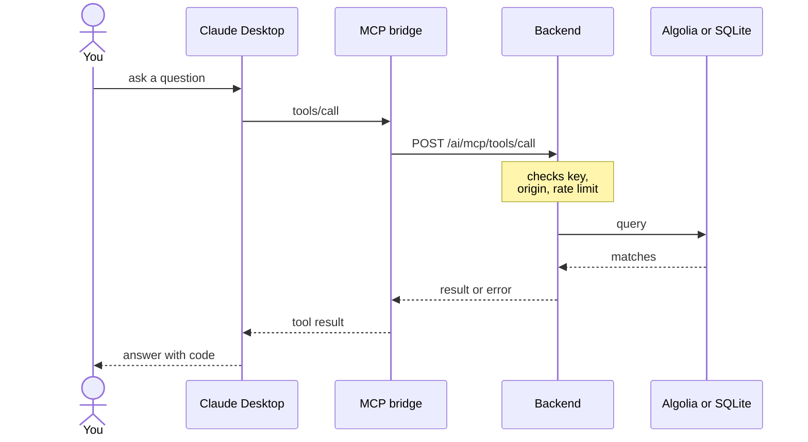

# CodeSage

[](https://github.com/ntanwir10/codesage-algolia-challenge/actions/workflows/ci.yml)

**Search and read codebases from Claude.** CodeSage indexes a repository's functions, classes, imports, documentation and Terraform blocks into Algolia, then serves them to Claude Desktop (or any MCP client) as seven tools. A web dashboard adds GitHub repositories, shows indexing progress live and searches the index. Claude can also add public repositories from other git hosts.

Built for the [Algolia MCP Server Challenge](https://dev.to/challenges/algolia-2025-07-09).



In development there is no nginx: the dashboard and the bridge call the backend directly.

## Contents

- [How it works](#how-it-works)
- [Quick start](#quick-start)
- [Using CodeSage](#using-codesage)
- [Security](#security)
- [Configuration](#configuration)
- [Deployment](#deployment)
- [Development](#development)
- [Known limitations](#known-limitations)

## How it works

There are two ways in, and both end at the same FastAPI backend:

- **Web dashboard** (React + Vite). Add a GitHub repository, watch it index, and search it.
- **Claude Desktop.** Claude Desktop starts `mcp_launcher.sh`, which runs a small stdio MCP bridge (`backend/codesage_mcp`). The bridge turns Claude's tool calls into HTTP calls to the backend. Claude can search, read and also add repositories, including public ones on GitLab, Bitbucket and other git hosts.

Indexing runs as a background job inside the backend. Search goes to Algolia; reading files and listing definitions go to SQLite.

### Inside the backend



### Adding a repository



The dashboard shows every refusal under the repository field and stays on the Home page. Nothing is created on any of them. The REST endpoint and the dashboard take github.com only. The `add_repository` tool runs the same checks for other hosts, with the messages in [Other git hosts](#other-git-hosts).

| You see | Status | Cause |
| --- | --- | --- |
| A message about the URL or branch | 422 | Not a GitHub repository URL, or an invalid branch name |
| "GitHub repository owner/repo was not found" | 422 | The repository doesn't exist, or it's private and the server's `GITHUB_TOKEN` can't read it |
| "Branch 'x' does not exist", "owner/repo is empty" or "GitHub denied access" | 422 | The branch is missing, the repository has no content, or GitHub refused access |
| "owner/repo has already been added", with an "Open it" link | 409 | Same URL as an existing repository. Case doesn't matter. The body also has `repository_id` |
| "GitHub's API rate limit was reached; try again in about N minutes" | 503 | GitHub is rate-limiting the server. `Retry-After` says how long |
| "GitHub rejected the server's GITHUB_TOKEN" or "Could not reach GitHub; try again" | 502 | The token is invalid, or GitHub is down or unreachable |
| "GitHub did not respond in time; try again" | 504 | GitHub took longer than the 10 s check |
| "Search indexing is not configured on the server" | 503 | `ALGOLIA_APP_ID` or `ALGOLIA_ADMIN_API_KEY` is unset |

The GitHub check makes one attempt per call, with no retries. A repository that passes can still fail later, during the run; the dashboard then shows the reason on its card.

### The indexing run



Progress is pushed to the dashboard after every batch. A file that fails to parse is still stored, without entities. A repository too large for one GitHub tree call is also listed through the contents API, up to 300 directories; anything it never reaches counts as left out. Repositories on other hosts are read with a shallow `git clone` instead, and the same file rules apply.

### Repository status



A repository can't be deleted while its job is running. Delete returns as soon as Algolia accepts the removal; it doesn't wait for Algolia to finish.

### Using the web dashboard



Progress arrives over the WebSocket, with polling every 3 seconds as well.

### Using it from Claude Desktop



Each tool call takes this path:



- **Bridge.** It talks to Claude Desktop over stdio and checks the arguments first. It won't send the key over plain `http://` to a remote host.
- **nginx.** In prod the request goes through nginx, which checks your login and adds the API key.
- **Backend.** `search_code` queries Algolia; the other tools read SQLite.
- **Errors.** A rejected key or login (`401`), a refused host (`403`), a wrong URL (`404`), bad arguments (`422`), a rate limit (`429`), a backend error (`5xx`), a timeout or an unreachable backend comes back to Claude as a tool error that says what to fix. Every tool also refuses a repository that failed or is still indexing, and says why or how far along it is.

More detail is in [docs/architecture.md](docs/architecture.md) (data model, search index, WebSocket protocol) and [docs/MCP_INTEGRATION_GUIDE.md](docs/MCP_INTEGRATION_GUIDE.md) (tools, arguments, troubleshooting).

### Supported languages

| Language | Parser | Entities |
| --- | --- | --- |
| Python | `ast`, with a line scanner for files `ast` can't parse | functions, classes, methods, imports |
| JavaScript, TypeScript, Java, Go, Rust, C, C++, C#, PHP, Ruby | tree-sitter | functions, classes, methods, imports |
| Markdown | heading scanner | a `doc_section` per heading |
| Terraform (`.tf`, `.tfvars`), HCL (`.hcl`) | tree-sitter HCL grammar | a `terraform_block` per top-level block, named like `resource aws_s3_bucket.logs`, `module network`, `variable region` or `output api_url` |
| CSS, HTML, JSON, YAML, XML | none | stored and readable, but no entities |

## Quick start

You need:

- Python 3.13 and [`uv`](https://docs.astral.sh/uv/) (or any way to create `.venv` at the repo root)
- Node.js 22 and npm
- An Algolia application ID and Admin API key. Without them the backend still starts, but adding a repository returns `503` and `/health` reports `degraded`.
- A GitHub token. It's optional but recommended; without one, GitHub's low unauthenticated rate limit applies, and private repositories can't be read.

**1. Install.**

```bash
make setup
```

This copies `.env.example` to `backend/.env` if it's missing, creates `.venv` and installs the backend dependencies into it, and runs `npm ci` in `frontend/`. It stops with a message if Python 3.13 (or `uv`) or Node 22 is missing.

**2. Configure.** Edit `backend/.env`:

```bash
ALGOLIA_APP_ID=...
ALGOLIA_ADMIN_API_KEY=...
GITHUB_TOKEN=...
```

You don't need to create `CODESAGE_API_KEY`. `make setup`, `make start` and `make install-claude` generate it in `backend/.env` if it's missing, copy it to `frontend/.env` as `VITE_CODESAGE_API_KEY`, and keep the two in sync. To rotate it, delete the `CODESAGE_API_KEY` line in `backend/.env`, run `make setup` and `make install-claude`, and restart Claude Desktop and Vite. A value left empty, or left as a `your-...-here` placeholder, counts as unset. See [Security](#security).

**3. Run.**

```bash
make start   # backend on http://127.0.0.1:8001, dashboard on http://localhost:5173
```

`make start` waits up to 15 seconds for the backend to answer `/health`, and exits with an error if it doesn't. The dashboard needs port 5173; if it's taken, Vite exits instead of picking another port. `make start-backend` and `make start-frontend` run them separately, `make stop` stops both, and `make health` reports whether the backend answers. API docs are at http://127.0.0.1:8001/docs.

**4. Index a repository.** Open http://localhost:5173 and enter `owner/repo` (a pasted GitHub URL works too). The repository page shows progress live and turns searchable when it's done. If GitHub or Algolia refuses the repository, the form says why; see [Adding a repository](#adding-a-repository).

**5. Connect Claude Desktop.**

```bash
make install-claude                 # add CodeSage to the Claude Desktop config
make install-claude ARGS=--dry-run  # preview first; the key is masked
```

Restart Claude Desktop and keep the backend running. Then ask Claude something like *"Search the zustand repository for where the store is created"*.

## Using CodeSage

### Web dashboard

| Page | What you can do |
| --- | --- |
| Home (`/`) | Add a GitHub repository. The field has a `github.com/` prefix: type `owner/repo` or paste a GitHub URL, and it is trimmed to `owner/repo`. The branch has its own optional field. |
| Repository (`/repository/:id`) | Watch indexing progress. Afterwards, search with suggestions and open results at the exact line. The source link says "View on GitHub", or "View source" for a repository on another host. Reprocess or delete the repository. |
| Dashboard (`/dashboard`) | All repositories with their status and progress. Delete a repository from here. |

A finished repository shows a green card. It shows amber if it was only partially indexed and red if it failed; both say why.

An unknown path shows "Page not found". A repository that doesn't exist says so; any other load error shows the message with "Try again". A failed repository says why on its page and on its dashboard card.

### Claude Desktop and MCP tools

| Tool | What it returns |
| --- | --- |
| `list_repositories` | Indexed repositories with status and size |
| `search_code` | Full-text matches over functions, classes, imports, doc sections and Terraform blocks, with source links. A question in plain words returns the best partial matches |
| `get_file` | A file with line numbers: at most 400 lines and 100,000 characters per call |
| `list_definitions` | Definitions in a repository, by file and line |
| `analyze_repository` | File, line and entity counts, languages, top directories, largest files |
| `find_patterns` | Literal or regex line matches. Regex search stops after 10 s per call |
| `add_repository` | Adds a repository by https URL and starts indexing. Public repositories on any git host; needs the API key |

The installer merges CodeSage into your Claude Desktop config without touching other servers. It writes a backup first, and both files are mode 600 because they hold the key.

For the HTTPS prod stack, use `make install-claude ARGS="--server-url https://your-host --basic-auth <user>"`. The password goes to the macOS Keychain, and nginx supplies the API key. See [docs/MCP_INTEGRATION_GUIDE.md](docs/MCP_INTEGRATION_GUIDE.md) for manual setup and troubleshooting.

### Other git hosts

Ask Claude: *"Add https://gitlab.com/group/project to CodeSage"*. Claude calls `add_repository` and you follow progress with `list_repositories`.

- **Hosts.** https URLs on GitHub, GitLab (nested groups too), Bitbucket and self-hosted servers. Branch URLs such as `.../-/tree/dev` work.
- **Public only.** Private repositories are refused on every host but github.com, where the server's `GITHUB_TOKEN` can read them. The message is "... was not found or is private; only public repositories are supported on <host>."
- **Rejected URLs.** Ports, credentials, `localhost` and private IP addresses.
- **Names and links.** Repositories on other hosts are named `<host>/<path>`. Search results link to GitLab and Bitbucket at the exact line. Other hosts get no link.
- **Not in the dashboard.** The web form and `POST /api/v1/repositories/` take github.com only.
- **Needs git.** The backend runs `git ls-remote` to check (10 s) and a shallow `git clone` to read (120 s). The prod Docker image includes git.

### REST API

Everything the dashboard does is plain HTTP under `/api/v1`. To index a repository from the command line:

```bash
curl -X POST http://127.0.0.1:8001/api/v1/repositories/ \
  -H "Content-Type: application/json" -H "X-API-Key: $CODESAGE_API_KEY" \
  -d '{"url": "https://github.com/owner/repo"}'
```

- **Create.** GitHub is checked first; see [Adding a repository](#adding-a-repository). The response is `201`, and a background job starts. A duplicate URL gets `409` with `{detail, repository_id}`; URLs match regardless of case. A bad URL or branch gets `422` with `loc` of `["body","url"]` or `["body","branch"]`. A missing or private repository, a missing branch or an empty repository gets `422` with a string `detail`. A GitHub or network problem gets `502`, `503` (with `Retry-After` on a rate limit) or `504`, and an unconfigured Algolia gets `503`. A URL on another host gets `422`; those go in through the `add_repository` tool.
- **Status.** Poll `GET /api/v1/repositories/{id}/status`; it includes `error_message`. For push updates, connect to `/ws`, send `{"type": "subscribe", "repository_id": N}` and read `{type, data}` frames.
- **Reprocess.** `POST /api/v1/repositories/{id}/process?force_reprocess=true` re-runs indexing and returns `202` and sets the repository to `processing` first. It returns `409` while a job is running, and `503` if Algolia isn't configured.
- **Edit.** `PUT /api/v1/repositories/{id}` returns `409` if it would change `branch`, `language` or `framework` while a job or a delete holds the repository; other fields can change at any time. An empty `branch` means the default branch.
- **Delete.** `DELETE /api/v1/repositories/{id}` sends the removal to Algolia and returns without waiting for Algolia to finish. That is safe because Algolia applies an index's tasks in order, so a later re-add that reuses the id still lands after the delete. It returns `409` while a job is running. If Algolia refuses the request it returns `502` and the repository stays. Reprocess still waits.
- **Restarts.** A server restart marks interrupted runs `failed`; reprocess them.
- **Errors.** Errors are `{"detail": "..."}`. Validation errors (`422`) carry a list instead, with the field in `loc`. An id or `skip` too large for the database is `422`. Rate limiting (`429`) sends `Retry-After`. A `500` has `{detail, request_id}`, the same ID as the `X-Request-ID` header and the server log, and carries CORS headers so a browser can read it.
- **Health.** `GET /health` is `200` `healthy`, `200` `degraded` when Algolia is unreachable or not configured, and `503` `unhealthy` when the database fails.

## Security

- **API key.** When `CODESAGE_API_KEY` is set, it's required for:
  - every write: create, update, delete and process;
  - `/api/v1/performance/*`, search suggestions, the MCP tool call and resource reads;
  - the `/ws` WebSocket.

  Send it as an `X-API-Key` header. Browsers send it on the WebSocket as a `codesage.key.<hex>` subprotocol, so it never appears in a URL or an access log. Other reads (repositories, status, stats, tool listings, `/health`) are public.
- **Running without a key** is allowed only on loopback. The backend refuses to start on a non-loopback `MCP_SERVER_HOST` without one. Even then, it serves only local clients that address it as `localhost`, `127.0.0.1` or `[::1]`, which blocks DNS rebinding and LAN access.
- **Hosts, when a key is set.** The API answers only to loopback hosts, the `CORS_ORIGINS` hosts and those listed in `ALLOWED_HOSTS`. Any other `Host` gets `403`, which blocks DNS rebinding even though the dev bundle embeds the key.
- **Cross-site requests.** Browser writes and WebSocket connections from an origin that is neither in `CORS_ORIGINS` nor the API's own origin are refused with `403`.
- **The key in the bundle.** `VITE_*` variables end up in the JavaScript bundle, so outside the prod stack anyone who can load the dashboard can read the key. Use that setup locally, for one user. The prod stack keeps the key in nginx behind basic auth instead.
- **The MCP bridge** refuses to send the key or a login over plain `http://` to a non-loopback host.

## Configuration

`backend/.env` (see `.env.example`):

| Variable | Default | Notes |
| --- | --- | --- |
| `CODESAGE_API_KEY` | generated by `make setup` | Required unless the server listens on loopback only. Generated if missing and copied to `frontend/.env`; see [Configure](#quick-start) |
| `MCP_SERVER_HOST`, `MCP_SERVER_PORT` | `127.0.0.1`, `8001` | A non-loopback host requires the key |
| `ALGOLIA_APP_ID`, `ALGOLIA_ADMIN_API_KEY` | unset | Required for indexing and search. Empty or `your-...-here` values count as unset: adding or reprocessing a repository returns `503`, MCP search says Algolia isn't configured, and `/health` is `degraded` |
| `ALGOLIA_INDEX_NAME` | `codesage_code_entities` | One index per database; the Compose files use their own |
| `GITHUB_TOKEN` | unset | Raises GitHub rate limits and allows private github.com repositories. If GitHub rejects it, adding a repository returns `502` |
| `DATABASE_URL` | `sqlite:///./codesage.db` | SQLite only |
| `CORS_ORIGINS` | localhost ports 3000, 5173, 5174 | Comma-separated list of origins; `*` is rejected. Also decides which browser origins may write |
| `ALLOWED_HOSTS` | unset | With a key set, extra hostnames the API answers to, besides loopback and the `CORS_ORIGINS` hosts. Comma-separated; `*.example.com` allows subdomains, `*` allows any host |
| `ENVIRONMENT`, `LOG_LEVEL` | `development`, `INFO` | `production` hides `/docs` |

Rate limits are per client address: 100 per minute for repository create and process and for search suggestions, and 30 per minute for MCP tool calls and resource reads.

## Deployment

| Stack | Command | What you get |
| --- | --- | --- |
| Dev | `export CODESAGE_API_KEY=...` then `make up` | nginx on http://localhost and the backend on :8001, both bound to 127.0.0.1 |
| Prod | `make prod-build && make prod-up` | HTTPS on 443 behind basic auth, with nginx adding the API key. Port 80 answers `/health` and redirects everything else |

Prod needs a certificate in `deployment/ssl/`, a login in `deployment/htpasswd`, and your domain in `CORS_ORIGINS`. If the site is also reached under another name or by IP, export those hostnames in `ALLOWED_HOSTS`, or they get `403`. See [deployment/DOCKER.md](deployment/DOCKER.md) for setup, and for why each stack uses its own Algolia index.

## Development

```bash
make test                         # backend tests
.venv/bin/ruff check backend      # backend lint
cd frontend && npm test           # frontend unit tests
cd frontend && npm run lint
cd frontend && npm run build      # type-check and production build
```

CI ([.github/workflows/ci.yml](.github/workflows/ci.yml)) runs on pushes to `master` and on every pull request. It runs the backend lint and tests, the frontend lint, build and tests, validates both Compose files and both nginx configs (`nginx -t`), and builds both Docker images.

```
backend/app/            FastAPI app: api/ (routes), core/ (config, auth, database), models/, schemas/, services/
backend/codesage_mcp/   stdio MCP bridge Claude Desktop runs (python -m codesage_mcp)
backend/alembic/        database migrations, applied at startup
backend/tests/          pytest suite
frontend/src/           React dashboard: pages/, components/, services/ (API and WebSocket clients)
deployment/             Compose files, dev nginx.conf and the prod nginx template
docs/                   architecture notes and the MCP guide
scripts/                install_claude_desktop.py
mcp_launcher.sh         what Claude Desktop launches
```

## Known limitations

- **One worker.** Run exactly one: job state, the two-run limit and WebSocket subscriptions live in the server process.
- **SQLite only.** Migrations run at startup, and a database from before Alembic is stamped first.
- **Synchronous Algolia client.** Its calls run in worker threads.
- **Tests and CI.** Frontend tests are unit tests only. CI builds the Docker images but never runs them; the prod stack was last run by hand.
- **Search scope.** Searching across all repositories includes ones that are being reprocessed.
