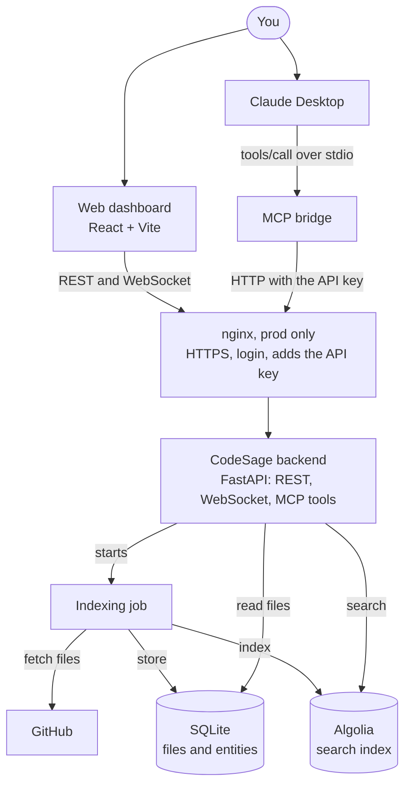
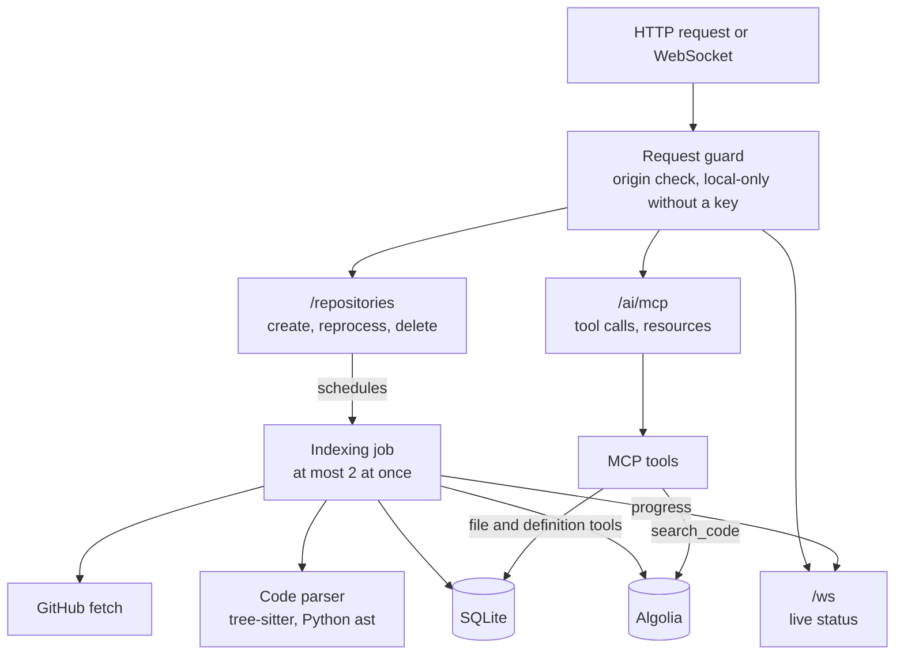
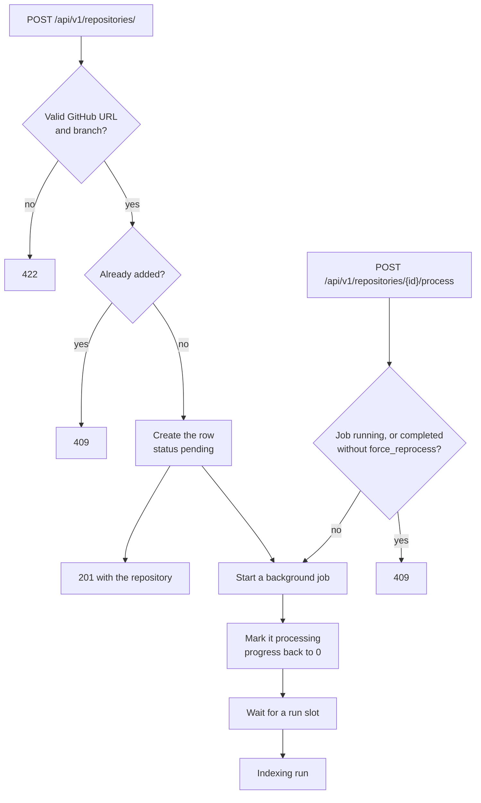
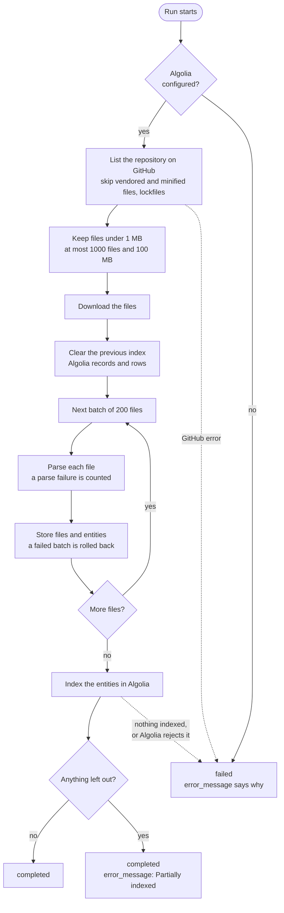
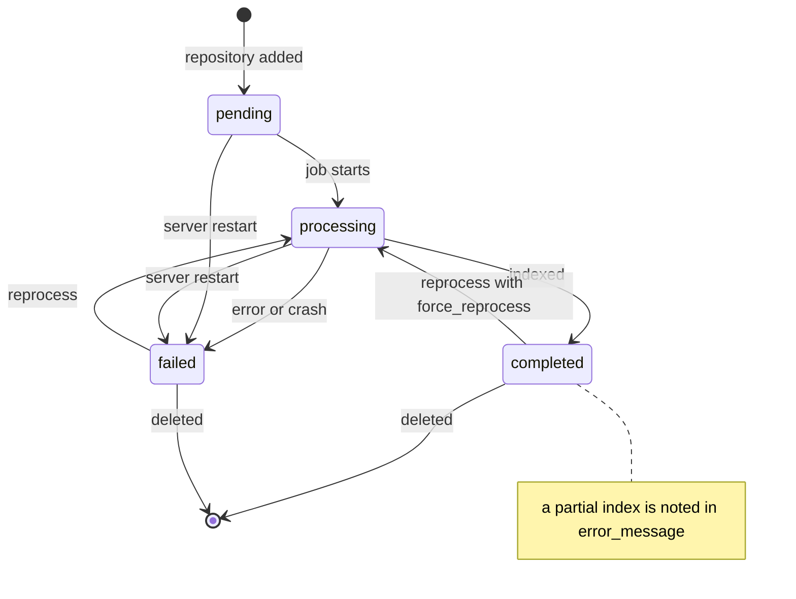
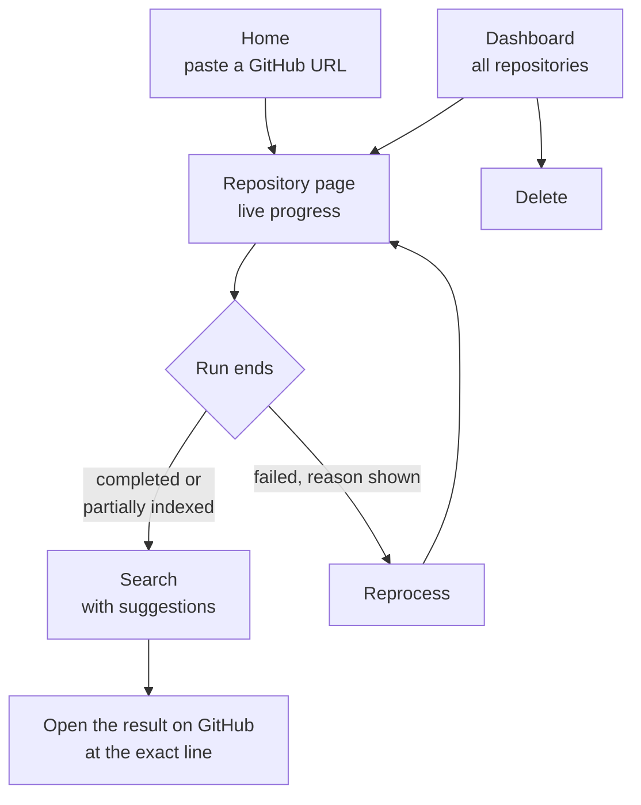
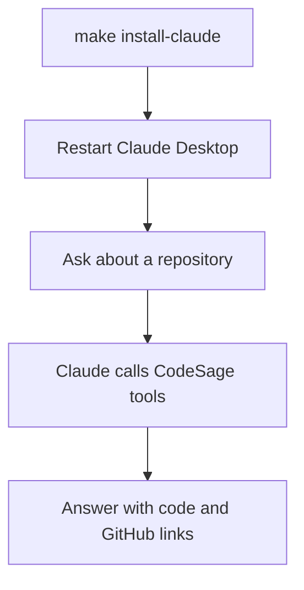
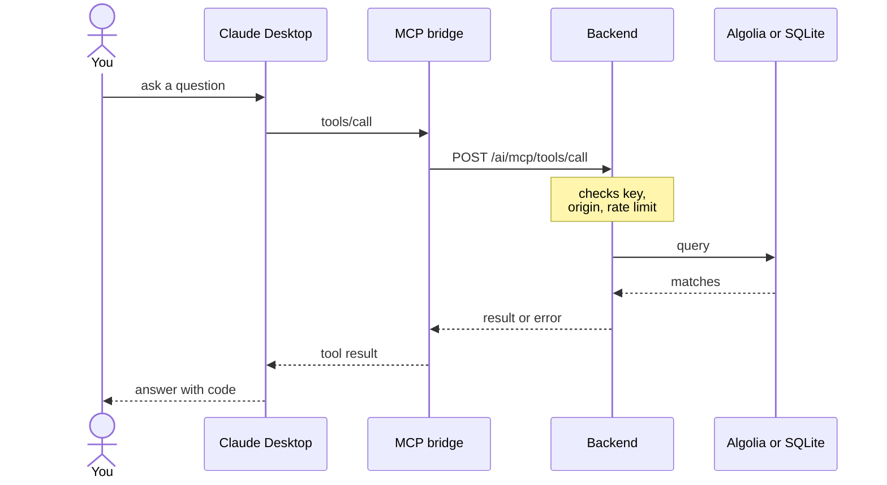

# CodeSage

[](https://github.com/ntanwir10/codesage-algolia-challenge/actions/workflows/ci.yml)

**Search and read GitHub codebases from Claude.** CodeSage indexes a repository's functions, classes, imports and documentation into Algolia, then serves them to Claude Desktop (or any MCP client) as six tools. A web dashboard adds repositories, shows indexing progress live and searches the index.

Built for the [Algolia MCP Server Challenge](https://dev.to/challenges/algolia-2025-07-09).



In development there is no nginx: the dashboard and the bridge call the backend directly.

## Contents

- [How it works](#how-it-works)
- [Quick start](#quick-start)
- [Using CodeSage](#using-codesage)
- [Security](#security)
- [Configuration](#configuration)
- [Deployment](#deployment)
- [Development](#development)
- [Known limitations](#known-limitations)

## How it works

There are two ways in, and both end at the same FastAPI backend:

- **Web dashboard** (React + Vite). Add a GitHub repository, watch it index, and search it.
- **Claude Desktop.** Claude Desktop starts `mcp_launcher.sh`, which runs a small stdio MCP bridge (`backend/codesage_mcp`). The bridge turns Claude's tool calls into HTTP calls to the backend.

Indexing runs as a background job inside the backend. Search goes to Algolia; reading files and listing definitions go to SQLite.

### Inside the backend



### Adding a repository



### The indexing run



Progress is pushed to the dashboard after every batch. A file that fails to parse is still stored, without entities.

### Repository status



A repository can't be deleted while its job is running.

### Using the web dashboard



Progress arrives over the WebSocket, with polling every 3 seconds as well.

### Using it from Claude Desktop



Each tool call takes this path:



- **Bridge.** It talks to Claude Desktop over stdio and checks the arguments first. It won't send the key over plain `http://` to a remote host.
- **nginx.** In prod the request goes through nginx, which checks your login and adds the API key.
- **Backend.** `search_code` queries Algolia; the other tools read SQLite.
- **Errors.** A `401`, `422` or `429`, or an unreachable backend, comes back to Claude as a tool error that says what to fix.

More detail is in [docs/architecture.md](docs/architecture.md) (data model, search index, WebSocket protocol) and [docs/MCP_INTEGRATION_GUIDE.md](docs/MCP_INTEGRATION_GUIDE.md) (tools, arguments, troubleshooting).

### Supported languages

| Language | Parser | Entities |
| --- | --- | --- |
| Python | `ast`, with a line scanner for files `ast` can't parse | functions, classes, methods, imports |
| JavaScript, TypeScript, Java, Go, Rust, C, C++, C#, PHP, Ruby | tree-sitter | functions, classes, methods, imports |
| Markdown | heading scanner | a `doc_section` per heading |
| CSS, HTML, JSON, YAML, XML | none | stored and readable, but no entities |

## Quick start

You need:

- Python 3.13 and [`uv`](https://docs.astral.sh/uv/) (or any way to create `.venv` at the repo root)
- Node.js 22 and npm
- An Algolia application ID and Admin API key
- A GitHub token. It's optional but recommended; without one, GitHub's low unauthenticated rate limit applies.

**1. Install.**

```bash
make setup
```

This copies `.env.example` to `backend/.env` if it's missing, creates `.venv` and installs the backend dependencies into it, and runs `npm ci` in `frontend/`.

**2. Configure.** Edit `backend/.env`:

```bash
ALGOLIA_APP_ID=...
ALGOLIA_ADMIN_API_KEY=...
GITHUB_TOKEN=...
CODESAGE_API_KEY=...   # generate one with the command below
```

```bash
python -c "import secrets; print(secrets.token_urlsafe(32))"
```

For the dashboard, put the same key in `frontend/.env.local` as `VITE_CODESAGE_API_KEY=...`. The key is optional while the backend only listens on `127.0.0.1`; see [Security](#security).

**3. Run.**

```bash
make start   # backend on http://127.0.0.1:8001, dashboard on http://localhost:5173
```

`make start-backend` and `make start-frontend` run them separately, and `make stop` stops both. API docs are at http://127.0.0.1:8001/docs.

**4. Index a repository.** Open http://localhost:5173 and paste a GitHub URL. The repository page shows progress live and turns searchable when it's done.

**5. Connect Claude Desktop.**

```bash
make install-claude                 # add CodeSage to the Claude Desktop config
make install-claude ARGS=--dry-run  # preview first; the key is masked
```

Restart Claude Desktop and keep the backend running. Then ask Claude something like *"Search the zustand repository for where the store is created"*.

## Using CodeSage

### Web dashboard

| Page | What you can do |
| --- | --- |
| Home (`/`) | Add a repository by URL, optionally with a branch. `https://github.com/owner/repo/tree/<branch>` works too. |
| Repository (`/repository/:id`) | Watch indexing progress. Afterwards, search with suggestions and open results on GitHub at the exact line. Reprocess or delete the repository. |
| Dashboard (`/dashboard`) | All repositories with their status and progress. Delete a repository from here. |

A finished repository shows a green card. It shows amber if it was only partially indexed and red if it failed; both say why.

### Claude Desktop and MCP tools

| Tool | What it returns |
| --- | --- |
| `list_repositories` | Indexed repositories with status and size |
| `search_code` | Full-text matches over functions, classes, imports and doc sections, with GitHub links |
| `get_file` | A file with line numbers: at most 400 lines and 100,000 characters per call |
| `list_definitions` | Definitions in a repository, by file and line |
| `analyze_repository` | File, line and entity counts, languages, top directories, largest files |
| `find_patterns` | Literal or regex line matches. Regex search stops after 10 s per call |

The installer merges CodeSage into your Claude Desktop config without touching other servers. It writes a backup first, and both files are mode 600 because they hold the key.

For the HTTPS prod stack, use `make install-claude ARGS="--server-url https://your-host --basic-auth <user>"`. The password goes to the macOS Keychain, and nginx supplies the API key. See [docs/MCP_INTEGRATION_GUIDE.md](docs/MCP_INTEGRATION_GUIDE.md) for manual setup and troubleshooting.

### REST API

Everything the dashboard does is plain HTTP under `/api/v1`. To index a repository from the command line:

```bash
curl -X POST http://127.0.0.1:8001/api/v1/repositories/ \
  -H "Content-Type: application/json" -H "X-API-Key: $CODESAGE_API_KEY" \
  -d '{"url": "https://github.com/owner/repo"}'
```

- **Create.** The response is `201`, and a background job starts. A duplicate URL gets `409`.
- **Status.** Poll `GET /api/v1/repositories/{id}/status`. For push updates, connect to `/ws`, send `{"type": "subscribe", "repository_id": N}` and read `{type, data}` frames.
- **Reprocess.** `POST /api/v1/repositories/{id}/process?force_reprocess=true` re-runs indexing and returns `202`. It returns `409` while a job is running.
- **Restarts.** A server restart marks interrupted runs `failed`; reprocess them.

## Security

- **API key.** When `CODESAGE_API_KEY` is set, it's required for:
  - every write: create, update, delete and process;
  - `/api/v1/performance/*`, search suggestions, the MCP tool call and resource reads;
  - the `/ws` WebSocket.

  Send it as an `X-API-Key` header. Browsers send it on the WebSocket as a `codesage.key.<hex>` subprotocol, so it never appears in a URL or an access log. Other reads (repositories, status, stats, tool listings, `/health`) are public.
- **Running without a key** is allowed only on loopback. The backend refuses to start on a non-loopback `MCP_SERVER_HOST` without one. Even then, it serves only local clients that address it as `localhost`, `127.0.0.1` or `[::1]`, which blocks DNS rebinding and LAN access.
- **Cross-site requests.** Browser writes and WebSocket connections from an origin that is neither in `CORS_ORIGINS` nor the API's own origin are refused with `403`.
- **The key in the bundle.** `VITE_*` variables end up in the JavaScript bundle, so outside the prod stack anyone who can load the dashboard can read the key. Use that setup locally, for one user. The prod stack keeps the key in nginx behind basic auth instead.
- **The MCP bridge** refuses to send the key or a login over plain `http://` to a non-loopback host.

## Configuration

`backend/.env` (see `.env.example`):

| Variable | Default | Notes |
| --- | --- | --- |
| `CODESAGE_API_KEY` | unset | Required unless the server listens on loopback only |
| `MCP_SERVER_HOST`, `MCP_SERVER_PORT` | `127.0.0.1`, `8001` | A non-loopback host requires the key |
| `ALGOLIA_APP_ID`, `ALGOLIA_ADMIN_API_KEY` | unset | Required for indexing |
| `ALGOLIA_INDEX_NAME` | `codesage_code_entities` | One index per database; the Compose files use their own |
| `GITHUB_TOKEN` | unset | Raises GitHub rate limits |
| `DATABASE_URL` | `sqlite:///./codesage.db` | SQLite only |
| `CORS_ORIGINS` | localhost ports 3000, 5173, 5174 | Comma-separated list of origins; `*` is rejected. Also decides which browser origins may write |
| `ENVIRONMENT`, `LOG_LEVEL` | `development`, `INFO` | `production` hides `/docs` |

Rate limits are per client address: 100 per minute for repository create and process and for search suggestions, and 30 per minute for MCP tool calls and resource reads.

## Deployment

| Stack | Command | What you get |
| --- | --- | --- |
| Dev | `export CODESAGE_API_KEY=...` then `make up` | nginx on http://localhost and the backend on :8001, both bound to 127.0.0.1 |
| Prod | `make prod-build && make prod-up` | HTTPS on 443 behind basic auth, with nginx adding the API key. Port 80 answers `/health` and redirects everything else |

Prod needs a certificate in `deployment/ssl/` and a login in `deployment/htpasswd`. See [deployment/DOCKER.md](deployment/DOCKER.md) for setup, and for why each stack uses its own Algolia index.

## Development

```bash
make test                         # backend tests
.venv/bin/ruff check backend      # backend lint
cd frontend && npm test           # frontend unit tests
cd frontend && npm run lint
cd frontend && npm run build      # type-check and production build
```

CI ([.github/workflows/ci.yml](.github/workflows/ci.yml)) runs on pushes to `master` and on every pull request. It runs the backend lint and tests, the frontend lint, build and tests, validates both Compose files and builds both Docker images.

```
backend/app/            FastAPI app: api/ (routes), core/ (config, auth, database), models/, schemas/, services/
backend/codesage_mcp/   stdio MCP bridge Claude Desktop runs (python -m codesage_mcp)
backend/alembic/        database migrations, applied at startup
backend/tests/          pytest suite
frontend/src/           React dashboard: pages/, components/, services/ (API and WebSocket clients)
deployment/             Compose files, dev nginx.conf and the prod nginx template
docs/                   architecture notes and the MCP guide
scripts/                install_claude_desktop.py
mcp_launcher.sh         what Claude Desktop launches
```

## Known limitations

- **One worker.** Run exactly one: job state, the two-run limit and WebSocket subscriptions live in the server process.
- **SQLite only.** Migrations run at startup, and a database from before Alembic is stamped first.
- **Synchronous Algolia client.** Its calls run in worker threads.
- **Tests and CI.** Frontend tests are unit tests only. CI builds the Docker images but never runs them.
- **Search scope.** Searching across all repositories includes ones that are being reprocessed.
