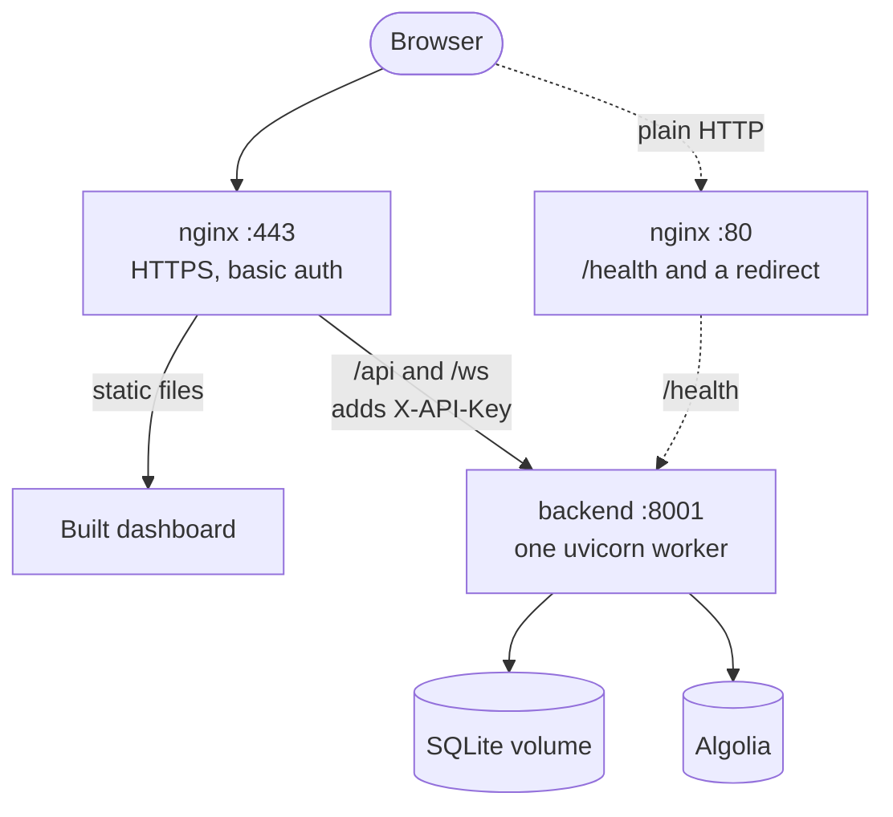

# Docker deployment

CodeSage ships two Compose stacks: a **dev** stack for one user on localhost, and a **prod** stack with HTTPS, basic auth and an nginx-held API key. This page covers setup, configuration, day-to-day commands and troubleshooting for both. CI validates both Compose files and nginx configs but never starts the containers, so expect to fix small problems at runtime.

## Contents

- [Dev and prod at a glance](#dev-and-prod-at-a-glance)
- [Dev stack](#dev-stack)
- [Prod stack](#prod-stack)
- [Configuration](#configuration)
- [Make targets](#make-targets)
- [Data and cleanup](#data-and-cleanup)
- [What CI checks](#what-ci-checks)
- [Troubleshooting](#troubleshooting)

## Dev and prod at a glance

| | Dev | Prod |
| --- | --- | --- |
| Compose file | `deployment/docker-compose.yml` | `deployment/docker-compose.prod.yml` |
| Backend image | `backend/Dockerfile` (source bind-mounted, uvicorn `--reload`) | `backend/Dockerfile.prod` (multi-stage, no bind mount, `--workers 1`, `ENVIRONMENT=production` so `/docs` and `/redoc` are off, while `/openapi.json` stays on but isn't routed by nginx; installs `curl` and `git`, which the `add_repository` tool uses to clone public repositories from hosts other than github.com) |
| nginx | `deployment/nginx.conf`, plain HTTP | `deployment/nginx.prod.conf.template`, HTTPS and basic auth |
| Containers | `codesage_mcp_server`, `codesage_nginx` | `codesage_mcp_server_prod`, `codesage_nginx_prod` |
| Published ports | `127.0.0.1:80` (nginx), `127.0.0.1:8001` (backend) | `80` and `443` (nginx). The backend is not published |
| TLS | none | `deployment/ssl/cert.pem` and `key.pem` |
| Auth | the API key in the browser bundle | basic auth in nginx (`deployment/htpasswd`) |
| Where the key lives | `backend/.env`, and the shell at build time (`VITE_CODESAGE_API_KEY`), which embeds it in the bundle | the shell (`CODESAGE_API_KEY`) for both backend and nginx. The bundle never has it |
| Algolia index | `codesage_code_entities_docker` (override `DOCKER_ALGOLIA_INDEX_NAME`) | `codesage_code_entities_prod` (override `PROD_ALGOLIA_INDEX_NAME`) |
| SQLite volume | `backend_data` | `backend_data_prod` |
| Make targets | `build`, `up`, `down`, `logs`, ... | `prod-build`, `prod-up` |

Both stacks run exactly one backend worker. Job state, WebSocket subscriptions and rate-limit counters live in the process, and SQLite is single-writer. Both publish port 80, so don't run them at the same time.

## Dev stack

The dev stack serves the built dashboard and proxies the API through nginx, with the backend also reachable directly.

1. **Create the env file.**

   ```bash
   cp .env.example backend/.env   # or run `make setup`
   ```

   Fill in `ALGOLIA_APP_ID`, `ALGOLIA_ADMIN_API_KEY`, `GITHUB_TOKEN` and `CODESAGE_API_KEY`. The backend reads this file through `env_file`. For `ALGOLIA_APP_ID`, `ALGOLIA_ADMIN_API_KEY` and `GITHUB_TOKEN`, a value left empty, or left as a `your-...-here` placeholder, counts as unset. That rule doesn't cover `CODESAGE_API_KEY`: Compose never runs `scripts/ensure_api_key.py`, so a placeholder key is used as the real key. Replace it, or run `make setup` first. Without Algolia the stack starts, but `/health` reports `degraded` and adding a repository returns `503`. `GITHUB_TOKEN` is optional.

2. **Generate a key and export it.**

   ```bash
   python -c "import secrets; print(secrets.token_urlsafe(32))"   # put this in backend/.env
   export CODESAGE_API_KEY=<the same key>                         # used at build time
   # after `make setup` the key already lives in backend/.env:
   # export CODESAGE_API_KEY=$(sed -n 's/^CODESAGE_API_KEY=//p' backend/.env)
   ```

3. **Build and start.**

   ```bash
   make build   # docker compose -f deployment/docker-compose.yml build
   make up      # same file, up -d
   ```

4. **Open it.** The app is at http://localhost and the backend at http://127.0.0.1:8001 (API docs at `/docs`).

- **Loopback only.** Both ports bind to `127.0.0.1`, because the bundle embeds the API key. Anyone who could reach them could read the key and call the write endpoints.
- **The key is mandatory.** The container listens on `0.0.0.0` (`MCP_SERVER_HOST`), so the backend refuses to start without `CODESAGE_API_KEY`.
- **The key is embedded.** Compose passes your shell's `CODESAGE_API_KEY` to the frontend build as `VITE_CODESAGE_API_KEY`, and Vite inlines it into the JavaScript. It must equal the value in `backend/.env`. Rebuild after changing it. This is acceptable for local, single-user use only.
- **Unknown hosts are dropped.** The dev nginx closes the connection (`444`) for any `Host` other than `localhost` or `127.0.0.1`, so a DNS-rebinding page can't fetch the bundle.
- **Overridden settings.** The Compose file sets `MCP_SERVER_HOST`, `MCP_SERVER_PORT`, `DATABASE_URL`, `ALGOLIA_INDEX_NAME` and `CORS_ORIGINS` (`http://localhost`, `:3000`, `:5173`) itself, and these win over `backend/.env`.
- **Hot reload.** `backend/` is bind-mounted into the container and uvicorn runs with `--reload --reload-dir app`.
- **No TLS.** Port 443 is not published.

## Prod stack

In prod, nginx terminates TLS, asks for a password, and adds the API key to each request. The browser never sees the key.



On port 80, `/health` is proxied to the backend and everything else gets a `301` to HTTPS, so a password never crosses plain HTTP. On 443, `/health` skips basic auth so load balancers and uptime checks need no login.

1. **Create the login.** The mount has `create_host_path: false`, so a missing file fails at start instead of becoming an empty directory.

   ```bash
   docker run --rm httpd:alpine htpasswd -nbB <user> <password> > deployment/htpasswd   # bcrypt entry
   ```

2. **Create the certificate.** `deployment/ssl/` must hold `cert.pem` and `key.pem`. For a self-signed pair:

   ```bash
   mkdir -p deployment/ssl
   openssl req -x509 -newkey rsa:2048 -nodes -days 365 -subj "/CN=your-host" \
     -addext "subjectAltName=DNS:your-host" \
     -keyout deployment/ssl/key.pem -out deployment/ssl/cert.pem   # use IP:1.2.3.4 for an IP
   ```

   Use a real certificate (for example from Let's Encrypt) for anything public. Both `deployment/htpasswd` and `deployment/ssl/` are gitignored.

3. **Set your domain.** In `deployment/docker-compose.prod.yml`, replace the `CORS_ORIGINS=https://yourdomain.com` placeholder with a comma-separated list of the origins people use, such as `https://app.example.com,https://other.example.com`.

4. **Export the key and any extra hosts.**

   ```bash
   export CODESAGE_API_KEY=...            # one value for backend and nginx; overrides backend/.env
   export ALLOWED_HOSTS=203.0.113.5,docs.example.com   # only if the site is reached by another name or IP
   ```

5. **Build and start.**

   ```bash
   make prod-build   # docker compose -f deployment/docker-compose.prod.yml build
   make prod-up      # same file, up -d; nginx waits for the backend healthcheck
   ```

### Hosts and origins

With a key set, the backend answers only to loopback hosts, the hosts in `CORS_ORIGINS`, and the hosts in `ALLOWED_HOSTS`. Any other `Host` gets `403`.

- **A site reached by another name or by IP.** Add that hostname or IP to `ALLOWED_HOSTS`, without a port. Browser writes and WebSocket connections are accepted from the API's own origin or an origin in `CORS_ORIGINS`, so a page served from that name works once the host is allowed.
- **Why nginx keeps the port.** On `/api` and `/ws` nginx sends `Host $http_host`, so a non-443 port stays in the header and matches the browser's `Origin`.

### Security headers and forwarded headers

- **Response headers.** nginx sends `Strict-Transport-Security` (2 years), `X-Content-Type-Options: nosniff`, `X-Frame-Options: DENY`, `Content-Security-Policy: frame-ancestors 'none'` and `Referrer-Policy: same-origin`. TLS is 1.2 and 1.3 only.
- **Overwritten, not appended.** nginx sets `X-Forwarded-For` to the real client address and `X-Forwarded-Proto` to `https`, and clears `Authorization`. A client can't choose its own address for rate limiting.
- **The key.** nginx sets `X-API-Key` itself on `/api` and `/ws`. Only `${CODESAGE_API_KEY}` is substituted in the template (`NGINX_ENVSUBST_FILTER`); nginx's own `$variables` are left alone.
- **uvicorn trust.** `Dockerfile.prod` starts uvicorn with `--forwarded-allow-ips "*"`. That is safe only because the backend has no published port and nginx is the only peer that can reach it. Keep it that way.
- **Limits.** `client_max_body_size` is 2 MB, and `/ws` allows idle connections for an hour.

### Claude Desktop against prod

```bash
make install-claude ARGS="--server-url https://your-host --basic-auth <user>"   # asks for the password
```

- **Password.** The installer stores it in the macOS Keychain (service `codesage-mcp`). The Claude Desktop config holds only the user name.
- **No key needed.** nginx adds the API key, so the bridge sends none.
- **Plain HTTP is refused.** The bridge won't send the login or a key over `http://` to a non-loopback host unless `CODESAGE_ALLOW_INSECURE_AUTH=1` is set in its `env`.
- **Self-signed certificate.** Add `SSL_CERT_FILE=/path/to/cert.pem` to the bridge's `env` in the Claude Desktop config.
- **Without the Keychain.** Set `CODESAGE_BASIC_AUTH_PASSWORD` in that `env` block instead. It is stored in plain text, in a file the installer keeps at mode 600.

## Configuration

| Variable | Where | Default | Notes |
| --- | --- | --- | --- |
| `CODESAGE_API_KEY` | shell, plus `backend/.env` for dev | none | Required by both stacks. Dev also bakes it into the bundle; prod gives it to nginx and the backend |
| `DOCKER_ALGOLIA_INDEX_NAME` | shell | `codesage_code_entities_docker` | Dev index |
| `PROD_ALGOLIA_INDEX_NAME` | shell | `codesage_code_entities_prod` | Prod index |
| `ALLOWED_HOSTS` | shell (prod only) | empty | Extra hostnames the API answers to, comma-separated, no port |
| `CORS_ORIGINS` | the Compose file | dev: localhost on 80, 3000, 5173. Prod: `https://yourdomain.com` | Edit the file; it overrides `backend/.env` |
| `DATABASE_URL` | the Compose file | `sqlite:///./data/codesage.db` | Lives in the data volume. Migrations run at startup |
| `ALGOLIA_APP_ID`, `ALGOLIA_ADMIN_API_KEY`, `GITHUB_TOKEN` | `backend/.env` | none | Read through `env_file` by both stacks |

Each stack uses its own Algolia index, and neither matches the local-run default `codesage_code_entities`. Records are keyed by repository id, so two databases sharing an index would delete each other's records.

## Make targets

| Target | What it does |
| --- | --- |
| `make build` / `make up` / `make down` | Build, start (`up -d`) and stop the dev stack |
| `make logs` / `make logs-backend` | Follow all dev logs, or the backend's |
| `make status` | `docker compose ps` for the dev stack |
| `make shell` | `bash` in the dev backend container |
| `make health` | Curls `http://127.0.0.1:8001/health` and the MCP capabilities (dev, needs `jq`). Prints the `/health` JSON even when it carries an error status. Prints "Backend not responding" if the backend can't be reached, the answer isn't JSON, or `jq` is missing (so without `jq` it says this even when the backend is up) |
| `make prod-build` / `make prod-up` | Build and start the prod stack |
| `make clean` | Stop the dev stack and delete its volumes |
| `make clean-all` | The same, plus the dev stack's locally built images |
| `make db-reset`, `db-migrate`, `db-migration` | Act on the local `backend/codesage.db`, not on the containers |

Every Docker target except `prod-build` and `prod-up` uses the dev file. For prod, call Compose directly:

```bash
docker compose -f deployment/docker-compose.prod.yml logs -f backend   # prod logs
docker compose -f deployment/docker-compose.prod.yml down              # stop prod; data is kept
curl -k https://localhost/health                                       # prod health, -k for a self-signed cert
```

## Data and cleanup

- **Dev data** is in the `backend_data` volume at `/app/data`. **Prod data** is in `backend_data_prod`. Both are named volumes and survive `down`.
- **`make clean`** runs `down -v --remove-orphans` on the dev file. It deletes the dev containers, network and volume, so the dev database is gone.
- **`make clean-all`** adds `--rmi local`, which also removes the dev stack's locally built images.
- **Scoped to this project.** Neither target runs a host-wide `docker system prune`, so other projects' containers, images and volumes are untouched. Neither touches the prod stack; to wipe prod data, run `down -v` with the prod file.
- **Algolia is not cleaned.** The index keeps its records. Delete repositories in the dashboard first, or remove the index in Algolia.

## What CI checks

The `docker` job runs on every push to `master` and every pull request:

- `docker compose config -q` on both Compose files.
- `nginx -t` on `nginx.conf`, and on the rendered prod template (with a throwaway certificate, htpasswd and key).
- `docker build` of `backend/Dockerfile.prod` and of `frontend/`.

It does not build the dev backend image (`backend/Dockerfile`) and never starts a container. The full prod stack was last run by hand with a self-signed certificate.

## Troubleshooting

| Symptom | Cause | Fix |
| --- | --- | --- |
| Backend exits immediately | `CODESAGE_API_KEY` is empty and the container binds `0.0.0.0` | Set the key and run `make logs-backend` to confirm |
| Dashboard shows `401`, or the WebSocket is rejected (dev) | The key in the bundle differs from the backend's | Re-export `CODESAGE_API_KEY` to match `backend/.env`, then `make build && make up` |
| `make prod-up` fails on a bind mount | `deployment/htpasswd` or `deployment/ssl/` is missing (`create_host_path: false`) | Create them as in [Prod stack](#prod-stack) |
| nginx exits with an SSL error (prod) | `cert.pem` or `key.pem` is missing or doesn't match | Regenerate the pair and check `docker compose -f deployment/docker-compose.prod.yml logs nginx` |
| `403` from the API in prod | The `Host` is not loopback, in `CORS_ORIGINS` or in `ALLOWED_HOSTS` | Add the hostname or IP to `ALLOWED_HOSTS` (no port) and restart |
| Writes or the WebSocket get `403` from a browser (prod) | The request's origin is neither the API's own nor in `CORS_ORIGINS` | Add the full origin, such as `https://host`, to the Compose file and restart |
| Browser asks for a login on every request | Wrong user or password in `htpasswd` | Recreate the file and restart nginx |
| Dev app returns an empty reply on another hostname | The dev nginx drops unknown `Host` values | Use `localhost` or `127.0.0.1` |
| Port 80 already in use | The dev and prod stacks both publish it, or another service does | Stop the other stack with `docker compose -f <file> down` |
| Prod backend is unhealthy and nginx never starts | nginx waits for the backend healthcheck, which fails on a non-2xx `/health`. The usual cause is the missing key; a database failure is the other | Read the backend logs |
| `/health` says `degraded`, or adding a repository returns `503` | Algolia is not configured, or unreachable. Empty Algolia values and `your-...-here` placeholders count as unset. `degraded` is still HTTP `200`, so the container stays healthy | Set `ALGOLIA_APP_ID` and `ALGOLIA_ADMIN_API_KEY` in `backend/.env`, then restart the stack |
| Adding a repository returns `422`, `502` or `504` | GitHub refused the repository, rejected `GITHUB_TOKEN`, or didn't answer one of its two requests within 10 s. The dashboard shows the message | Fix the URL or branch, or the token, and try again. A `503` with `Retry-After` is GitHub's rate limit |
| Repository ends in `failed` | `error_message` says why, for example a GitHub rate limit or an Algolia error. The dashboard card and `GET /api/v1/repositories/{id}/status` show it | Fix the cause, or set `GITHUB_TOKEN`, then reprocess |
| Claude Desktop can't reach prod | The bridge refuses plain `http://`, or doesn't trust a self-signed cert | Use `https://`, and add `SSL_CERT_FILE` to the bridge's `env` |
