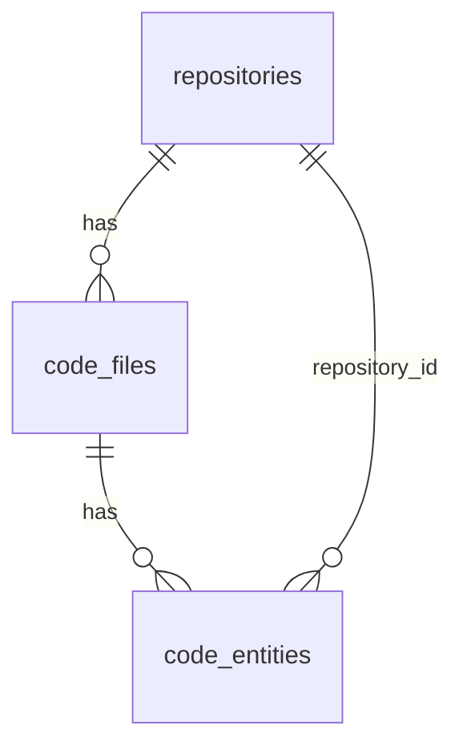

# Architecture

Reference for the parts of CodeSage the [root README](../README.md) only sketches: components, the data model, the ingestion pipeline, the search index, the WebSocket protocol and the security model. It is written for contributors and for anyone running the backend. The system, backend, indexing, status and tool-call diagrams are in the README under [How it works](../README.md#how-it-works).

## Contents

- [Components](#components)
- [Data model](#data-model)
- [Ingestion pipeline](#ingestion-pipeline)
- [Search](#search)
- [Real-time updates](#real-time-updates)
- [Security model](#security-model)
- [Known limitations](#known-limitations)

## Components

Everything runs in one backend process; the other parts are clients or proxies.

| Component | Path | Role |
| --- | --- | --- |
| App entry | `backend/app/main.py` | Builds the FastAPI app, validates settings, runs migrations and crash recovery at startup, and serves `/health` and `/ws`. Adds the request guard, CORS and an `X-Request-ID` header. |
| REST API | `backend/app/api/v1/endpoints/` | `repositories.py` (create, update, delete, status, stats, process), `ai.py` (MCP tool calls, resources, search suggestions) and `performance.py` (metrics). Mounted under `/api/v1`. |
| Core | `backend/app/core/` | `config.py` (settings and startup validation), `security.py` (API key, request guard, rate limiter, failure messages), `database.py` (engine, session) and `migrations.py` (Alembic at startup). |
| Models | `backend/app/models/` | SQLAlchemy tables: `Repository`, `CodeFile`, `CodeEntity`. |
| Services | `backend/app/services/` | `repository_service.py` (job lifecycle), `github_service.py` (listing and download), `git_source.py` (public repositories on other hosts, read with git), `code_parser.py` (entities), `algolia_service.py` (index and search), `mcp_tools.py` (the seven tools), `websocket_service.py` (live status) and `performance_monitor.py` (metrics). |
| MCP bridge | `backend/codesage_mcp/` | Stdio MCP server that Claude Desktop runs. It holds no data and turns `tools/list`, `tools/call`, `resources/list` and `resources/read` into HTTP calls to `/api/v1/ai`. Tool names and argument models live in `schemas.py`, which the backend imports too, so `tools/list` works with the backend down. Requests time out after 30 s, and a connection after 5 s. |
| Dashboard | `frontend/` | React + Vite. `services/api.ts` and `services/websocket.ts` are the REST and WebSocket clients. In the dev stack nginx serves the built bundle. |
| nginx | `deployment/nginx.conf`, `deployment/nginx.prod.conf.template` | Dev: HTTP proxy that drops requests for any `Host` except `localhost` and `127.0.0.1`. Prod: see [The prod nginx role](#the-prod-nginx-role). |

## Data model

SQLite holds repositories, their files and the parsed entities. Algolia holds a searchable copy of the entities.

| Table | Key columns |
| --- | --- |
| `repositories` | `id`, `name`, `description`, `url` (unique), `branch` (null means the default branch), `language`, `framework`, `status`, `error_message`, `total_files`, `processed_files`, `total_lines`, `created_at`, `updated_at`, `processed_at` |
| `code_files` | `id`, `repository_id`, `file_path` (up to 1000 characters), `content`, `language`, `line_count`, timestamps |
| `code_entities` | `id`, `file_id`, `repository_id`, `entity_type`, `entity_name` (up to 255), `start_line`, `end_line`, `signature`, `docstring`, `entity_metadata` (JSON: `parameters`, `return_type`), timestamps |

- **Status.** `status` is `pending`, `processing`, `completed` or `failed`. The transitions are in the README's [status diagram](../README.md#repository-status).
- **Entity types.** `function` (methods are stored as functions), `class`, `import`, `doc_section` and `terraform_block` (a top-level Terraform or HCL block, named like `resource aws_s3_bucket.logs`).
- **Cascade.** The ORM cascades `all, delete-orphan` from repository to files and from file to entities. Foreign keys carry no `ON DELETE`, and SQLite runs with `foreign_keys=ON`, so the service deletes entities, then files, with bulk queries before it deletes the repository row. The Algolia removal (`delete_by`) is sent first and not awaited: Algolia applies an index's tasks in order, so records indexed later under a reused id still land after the delete. If Algolia refuses the request, nothing is deleted and the API returns `502`.
- **Connection.** WAL journal mode and foreign keys are set on every connection.

### Migrations

Alembic migrations in `backend/alembic/versions` run at startup through `app/core/migrations.py`.

| Revision | What it does |
| --- | --- |
| `baseline` | Creates `repositories`, `code_files`, `code_entities`, plus `sessions` and `search_indexes`, which later revisions drop. |
| `cleanup` | Drops `sessions` and `search_indexes`. Removes duplicate repository URLs, keeping the highest `id`. Makes `url` unique. |
| `drop_unused_columns` | Drops unused columns: `full_name`, `start_column`, `end_column`, `complexity_score`, `is_public`, `is_async` on entities; `file_name`, `is_analyzed`, `size_bytes` on files; `repo_metadata`, `security_score`, `vulnerability_count` on repositories. |

- **Pre-Alembic databases.** If the app tables exist but `alembic_version` does not, the database is stamped at `baseline` and then upgraded.
- **In-memory SQLite.** It is created directly from the models, because a separate Alembic connection would see an empty database.

## Ingestion pipeline

A run turns a git repository into stored files, entities and Algolia records. The flow is drawn in the README's [indexing run](../README.md#the-indexing-run); this section gives the order and the numbers.

### Limits

| Limit | Value | Where |
| --- | --- | --- |
| Largest file | under 1 MB (a file of 1 MB or more is skipped) | `github_service.py` |
| Files per run | 1000 | `github_service.py` |
| Bytes per run | 100 MB | `github_service.py` |
| Contents-API walk | 300 directory requests, breadth-first | `github_service.py` |
| Concurrent GitHub downloads | 5 | `github_service.py` |
| Remote check on other hosts (`git ls-remote`) | 10 s | `git_source.py` |
| Clone on other hosts (`git clone --depth 1`) | 120 s | `git_source.py` |
| Retries | 3 attempts in total (2 retries), with exponential backoff, for timeouts, 429 and 5xx; a rate-limit reset is awaited for at most 60 s | `github_service.py` |
| Files per database commit | 200 | `repository_service.py` |
| Concurrent runs | 2 | `repository_service.py` |
| Records per Algolia request | 1000 | `algolia_service.py` |

### Steps

1. **Check and schedule.** `POST /repositories/` first rejects a duplicate URL (`409`, matched regardless of case), then requires Algolia to be configured (`503`), then checks the remote: for github.com `GitHubService.check_repository`, for any other host `git ls-remote` (see [Fetching by host](#fetching-by-host)). The GitHub check makes one GET for the repository and one for its branch, each with a 10 s timeout (so about 20 s at worst), and no retries or rate-limit sleeps. It maps problems to a status without creating a row: `422` for a missing, private, empty or denied repository or a missing branch; `502` for a rejected `GITHUB_TOKEN`, a network error or a GitHub 5xx; `503` with `Retry-After` for a rate limit; `504` for a timeout. Then `POST /repositories/` (`201`) or `POST /repositories/{id}/process` (`202`, also `503` without Algolia) starts an asyncio task. The task is refused with `409` if one is already running for that repository. `/process` sets the repository to `processing` before it returns, so a client polling `/status` never reads the old `failed`.
2. **Mark and wait.** The repository becomes `processing` with `processed_files` back at 0, and the status is broadcast. A run waits for one of two slots while already showing `processing`.
3. **Check Algolia.** The endpoints already refuse a missing configuration, so this only fails a run when the credentials went away after it was scheduled. The run fails with a message.
4. **List.** The branch is the repository's, the URL's, or the default branch from the GitHub API. For github.com, one recursive git trees call lists the blobs; symlinks are ignored. For other hosts, a shallow clone is walked instead (step 6 does not apply).
5. **Select.** Denied directories (`node_modules`, `dist`, `build`, `vendor`, `third_party`, `.git`, `__pycache__`, `.next`, `coverage`), minified and generated files (`*.min.js`, `*.min.css`, `*.bundle.js`, `*.map`), lockfiles, unknown extensions and files of 1 MB or more are dropped. The rest are kept in order until 1000 files or 100 MB, and the remainder counts as skipped. The order is source files first, then test files, then Markdown, then files that yield no entities (JSON, YAML, CSS, ...); each group is sorted by path.
6. **Truncated trees.** If GitHub marks the tree truncated, the contents API is walked breadth-first from the root, one request per directory and 300 at most, pruning denied directories. Its result is merged with the entries the truncated tree did return. If the cap is hit, the deepest unlisted directories are left out and the run is flagged.
7. **Download.** Files download five at a time (other hosts: read from the clone). Empty and binary files are skipped. One failed download fails the run. No files at all fails it too.
8. **Clear.** Only after a successful fetch are the repository's Algolia records, then its rows, deleted, so a transient GitHub error does not wipe a working index. The Algolia delete is awaited (up to 120 s), and if it fails the run fails. A plain repository delete does not wait.
9. **Parse and store.** Files are handled in batches of 200: parse each file, add the file and its entities, commit off the event loop, then broadcast progress.
10. **Index.** All records are sent to Algolia in batches of 1000. The run fails if there are no records, or if Algolia rejects the request.
11. **Finish.** The primary language is the most common programming language; Markdown, JSON, YAML, XML, CSS, SCSS, HTML and plain text do not count. The framework is detected from `package.json` dependencies (`next`, `@angular/core`, `vue`, `svelte`, `react`, `express`) or Python imports (`django`, `fastapi`, `flask`). The status becomes `completed`.

### Fetching by host

`repository_service.py` picks the source from the URL's host. `GitHubService` and `GitSource` share one `FileSelector`, so the deny list, extensions, size and count limits are the same.

| Host | Check | Fetch |
| --- | --- | --- |
| github.com | REST API (`check_repository`), private repositories readable with `GITHUB_TOKEN` | Trees and blobs API |
| Any other host | `git ls-remote --heads --symref`, 10 s | `git clone --depth 1 --single-branch --no-tags`, 120 s, into a temporary directory that is always removed |

- **Public only.** Git cannot ask for credentials, so a repository that answers 401, 403 or 404 is reported as "not found or is private; only public repositories are supported on <host>" (`422` at the check, `404` during a run).
- **No shell, no config.** Git runs through `create_subprocess_exec` with an empty `HOME`, no user or system config, no credential helper, `GIT_TERMINAL_PROMPT=0`, and only https allowed. It is killed on timeout.
- **Symlinks skipped.** The clone keeps symlinks as real links, and the tree walk (`_read_tree`) neither follows nor lists them.
- **URL limits.** `RepositoryCreate` first rewrites `http://` and `git@host:path` URLs to `https://`. `parse_repository_url` then accepts https only and rejects credentials, ports, `localhost`, private IP literals, and branch names that start with `-`.
- **Names and entry points.** Other hosts are named `<host>/<path>`. REST create takes github.com only; the `add_repository` MCP tool takes any host through the same service function.
- **Image.** The prod image installs `git`.

### Failure handling

- **Parse failure.** The file is still stored, without entities, and counted as unparsed.
- **Store failure.** A failed batch commit is rolled back, its files are counted as failed, its records are not indexed, and the run continues with the next batch.
- **Run failure.** Any other exception rolls back, sets `failed` with a message of at most 500 characters, and broadcasts it. A database error is recorded as a generic message, because its text carries SQL and file contents. A GitHub error is recorded as its own sentence, such as the rate-limit message with the wait. Other exceptions are recorded as `ClassName: message`. If a reprocess had already cleared the old index, the message ends with a note that the previous index was removed.
- **Partial index.** The run still ends `completed` when something was left out, and `error_message` starts with `Partially indexed:`. It names each cause: files that could not be stored, files that could not be parsed, files skipped over the 1000-file or 100 MB limit, and a listing too large to read in full. The repository page shows this as amber. The Dashboard card shows a plain "Completed" badge.
- **Job crash.** If the task itself dies, the row is set to `failed` ("Processing stopped unexpectedly") so it does not stay `processing`.
- **Server restart.** At startup, every repository left `pending` or `processing` is set to `failed` ("interrupted by a server restart"). Reprocess it to retry.
- **Delete.** A repository can't be deleted, or have `branch`, `language` or `framework` changed, while its job runs (`409`). A delete returns as soon as Algolia accepts the removal; a reprocess waits for it.

## Search

Entities are indexed as Algolia records, one per function, class, import, doc section or Terraform block. `AlgoliaService` builds the records and applies the settings; the settings are written once per process, and only when they differ from the live ones.

### Record fields

`build_documents` returns one record per entity.

| Field | Content |
| --- | --- |
| `objectID` | `<repository_id>_<sha1 of path:type:name:line>`, so re-indexing overwrites instead of duplicating |
| `repository_id`, `file_path`, `language` | Where the entity lives |
| `entity_type`, `entity_name` | `function`, `class`, `import`, `doc_section` or `terraform_block`; name capped at 500 characters |
| `description` | Docstring or summary, capped at 500 characters |
| `parameters`, `return_type` | Parameter names; return type capped at 500 characters |
| `line_start`, `line_end` | 1-based line range, used for source links |
| `signature` | Definition line, capped at 500 characters |
| `content` | Signature plus the body, with at most 2000 characters of body |
| `rank_weight` | `class` 3, `function` 2, `terraform_block` 2, `doc_section` 1, `import` 0 |
| `parameter_count`, `lines_of_code` | Derived counts |

A record is trimmed to 9000 bytes of JSON, `content` first and then `parameters`, because Algolia rejects a whole batch if one record is over 10 KB.

### Index settings

| Setting | Value |
| --- | --- |
| `searchableAttributes` | `entity_name`, `description`, `content`, `parameters`, `file_path`, in that order |
| `attributesForFaceting` | `filterOnly(repository_id)`, `entity_type`, `language`, `file_path` |
| `customRanking` | `desc(rank_weight)`: on a relevance tie, classes first, then functions and Terraform blocks, doc sections, imports |
| Highlighting | `<mark>` and `</mark>` |
| `hitsPerPage`, `maxValuesPerFacet` | 20, 100 |

### Queries

- **`search_code`.** The MCP tool resolves the repository by id, name or URL and requires it to be `completed`; a `failed`, `pending` or `processing` one is refused with the reason or the progress. It then queries Algolia with `repository_id=<n>` as a numeric filter (the facet form matches nothing), plus optional `language` and `entity_type` filters with escaped values. Without a repository it searches every repository, including any being reprocessed. Each query sends `removeWordsIfNoResults: allOptional`, `removeStopWords`, `ignorePlurals` and `queryLanguages: ["en"]`, so a question in plain words returns the best partial matches instead of nothing. Results carry a snippet (600 characters), signature and description (300 each) and a permalink at the exact lines: GitHub `#L`, GitLab `/-/blob/...#L` (gitlab.com and any host starting with `gitlab.`) or Bitbucket `/src/...#lines-` (bitbucket.org). Other hosts get no link. Every other tool refuses a repository that is not `completed`, with the reason or the progress. If Algolia is not configured, the tool says so. A failed query becomes a tool error that hides the Algolia host.
- **Suggestions.** `GET /api/v1/ai/search/suggestions` needs at least two characters, asks Algolia for twice the limit (1 to 20, default 10) and returns the distinct entity names in rank order. Any failure returns an empty list.
- **Writes and waits.** Indexing and the delete before a reprocess poll the Algolia task with a deadline (300 s to index, 120 s to delete), because the v3 client would wait forever. An indexing timeout is logged and the run goes on, since the records were accepted. A delete timeout fails the run. A plain repository delete sends `delete_by` and does not poll.
- **Threads.** The v3 client is synchronous, so each call runs in a worker thread, and there is one client per set of credentials.

## Real-time updates

`/ws` pushes repository status to the dashboard. The service is `websocket_service.py`. The README's [dashboard flow](../README.md#using-the-web-dashboard) covers when the UI uses it.

### Connection

- **Auth.** The key is read from a `codesage.key.<hex>` subprotocol, which is how browsers send it, or else from the `X-API-Key` header, which the prod nginx sends. With a key configured, a missing or wrong key is accepted and then closed with code 1008 and the reason "Invalid or missing API key", because a close before accept reaches browsers as 1006. With no key configured, any connection passes this check.
- **Request guard.** Before the endpoint runs, the guard closes the handshake with 1008 if the `Host` or `Origin` is refused. See [BrowserRequestGuard](#browserrequestguard).
- **Caps.** At most 200 open connections, and 20 from one client address. A new one over either cap is accepted and closed with 1013 and the reason "Too many connections; try again later", so the client's reconnect backoff applies. Behind the prod nginx, uvicorn takes the address from `X-Forwarded-For`.
- **Subprotocol.** `codesage` is echoed back when the client offered it.
- **Unexpected errors.** An exception in the handler closes the socket with 1011 and the reason "Internal error".

### Messages

| Frame | Direction | Payload |
| --- | --- | --- |
| `subscribe` | client to server | `{"type": "subscribe", "repository_id": N}` with a positive integer |
| `unsubscribe` | client to server | `{"type": "unsubscribe", "repository_id": N}` |
| `ping` | client to server | `{"type": "ping"}` |
| `connected` | server to client | `data.message`, `data.timestamp`; the client treats the connection as ready only after this |
| `subscribed` | server to client | `data.repository_id` |
| `unsubscribed` | server to client | `data.repository_id` |
| `pong` | server to client | no data |
| `error` | server to client | `data.message`: invalid JSON, not an object, unknown type, a bad `repository_id`, or more than 100 subscriptions on the connection |
| `repository_status` | server to client | `data`: `repository_id`, `status`, `name`, `processed_files`, `total_files`, `timestamp`, and `message` or `error` when set |

- **Subscriptions.** At most 100 per connection. Deleting a repository drops its subscribers.
- **Broadcast.** A `repository_status` frame goes to every subscriber of that repository, at the start, after each batch of 200 files and at the end of a run.
- **Send timeout.** Each send has a 5-second timeout. A client that fails or stalls is disconnected and closed. Sends go out concurrently over a snapshot, so a few stalled clients cost one timeout, not one each.
- **Polling.** The dashboard also polls the status endpoint every 3 seconds while a repository is in progress.

## Security model

The defaults protect a local, single-user setup; a key and the host checks protect anything reachable from a network.

### Where the API key is required

When `CODESAGE_API_KEY` is set, requests must carry it as `X-API-Key`, compared in constant time. It guards:

- repository create, update, delete and process, and the `add_repository` tool call;
- everything under `/api/v1/performance`;
- `GET /api/v1/ai/search/suggestions`, `POST /api/v1/ai/mcp/tools/call` and `GET /api/v1/ai/mcp/resources/read`;
- the `/ws` WebSocket.

Other reads are public: repository list, detail, status and stats, tool and resource listings, capabilities, `/` and `/health`. A `401` means a missing or wrong key.

### BrowserRequestGuard

`BrowserRequestGuard` in `app/core/security.py` is ASGI middleware for HTTP and WebSocket requests. A refusal is `403` for HTTP and close code 1008 for a WebSocket.

| Condition | Check |
| --- | --- |
| No key configured | The `Host` must be `localhost`, `127.0.0.1` or `[::1]`, and the TCP peer must be a loopback address. Blocks DNS rebinding and LAN clients when the server was bound to `0.0.0.0` by hand. |
| Key configured | The `Host` must be loopback, a `CORS_ORIGINS` host or listed in `ALLOWED_HOSTS` (`*.example.com` allows subdomains, `*` allows any host and logs a warning). |
| Request without a `Host` header | Allowed when a key is set, since browsers always send one (an HTTP/1.0 client, for example). Refused when no key is set. |
| `/health` | Exempt from the `Host` check, because load balancers often address it by IP. |
| Writes and WebSocket handshakes | If an `Origin` is present, it must be in `CORS_ORIGINS` or equal to the API's own scheme and host. A request with no `Origin` passes. |

The origin check exists because the prod nginx adds the key to any request carrying the browser's login, so the key alone cannot tell a hostile page from the dashboard.

### Startup validation

`validate_runtime_settings` runs when the app starts and refuses to start if:

- `CORS_ORIGINS` contains `*`, because credentials are allowed;
- `CODESAGE_API_KEY` is unset and `MCP_SERVER_HOST` is not a loopback address.

With no key on loopback it logs a warning. With a key, an `ALLOWED_HOSTS` of `*` logs a warning.

### Rate limits

Limits come from slowapi, per client address, and can be turned off with `ENABLE_RATE_LIMITING`. The limits are `RATE_LIMIT_DEFAULT` and `RATE_LIMIT_AI` in `config.py`.

| Endpoints | Limit |
| --- | --- |
| Repository create, repository process, search suggestions | 100 per minute |
| MCP tool calls, MCP resource reads | 30 per minute |

### Secrets and errors

- **Logs and responses.** An unhandled exception returns `500` with `{detail, request_id}` and an `X-Request-ID` header; the details go to the log under that ID. The response carries CORS headers for an allowed origin, because the handler sits outside the CORS middleware, so a browser can read it.
- **Shapes.** Errors are `{detail}` with a string. Validation errors (`422`) carry a list whose `loc` names the field, such as `["body","url"]`. A rate limit is `429` with `{detail}` and a `Retry-After` header. An id or `skip` too large for the database is `422`, not a `500`.
- **Recorded failures.** `failure_message` is used for `error_message`, WebSocket frames, metrics and parse logs. It replaces SQLAlchemy errors with a fixed message and truncates other errors to 500 characters.
- **Tool errors.** A failed Algolia query reaches Claude as "Search is unavailable", and the health check says only that Algolia is unreachable, because client errors can name the Algolia host or app id.
- **Key transport.** Browsers send the key to `/ws` in a subprotocol, so it never appears in a URL or an access log.
- **Key in the bundle.** `VITE_CODESAGE_API_KEY` is built into the dashboard JavaScript. Outside the prod stack, anyone who can load the dashboard can read it, so use it locally for one user.
- **Docs.** `/docs` and `/redoc` are off when `ENVIRONMENT=production`. `/openapi.json` stays on. In the prod stack nginx sends only `/api/`, `/ws` and `/health` to the backend, so the schema isn't reachable from outside.

### The prod nginx role

`deployment/nginx.prod.conf.template` is the only thing that holds the key in production:

- **TLS and login.** Port 443 requires basic auth, with the login file in `deployment/htpasswd`. Port 80 answers `/health` and redirects everything else to HTTPS.
- **Key injection.** nginx sets `X-API-Key` on every `/api/` and `/ws` request and clears `Authorization`, so the browser never holds the key.
- **Forwarding.** It passes `Host` with its port, `X-Forwarded-For` and `X-Forwarded-Proto: https`, which the origin check and the per-client WebSocket cap rely on.
- **Health.** `/health` skips basic auth. It returns `200` for `healthy` and `degraded` (Algolia unreachable or not configured) and `503` only when the database fails, so the Docker healthcheck stays green while Algolia is unset.

The bridge sends the key itself when it talks to the backend directly. Through nginx it uses the basic-auth login instead, and nginx supplies the key. It refuses to send either over plain `http://` to a non-loopback host.

## Known limitations

- **One worker.** Job state, the two-run limit and WebSocket subscriptions live in the process, so run exactly one worker.
- **SQLite only.** The database is a single local file.
- **Synchronous Algolia client.** Calls run in worker threads.
- **Partial results.** A repository over 1000 files or 100 MB, or too large for the trees API, is indexed in part. Source files are kept first, then tests, docs and data files.
- **No automatic retry.** An interrupted or failed run waits for a manual reprocess.
- **Search scope.** Searching all repositories includes ones being reprocessed.
- **Tests and CI.** Frontend tests are unit tests only. CI builds the Docker images but never runs them; the prod stack, with nginx, basic auth and the browser checks, was last run by hand.
