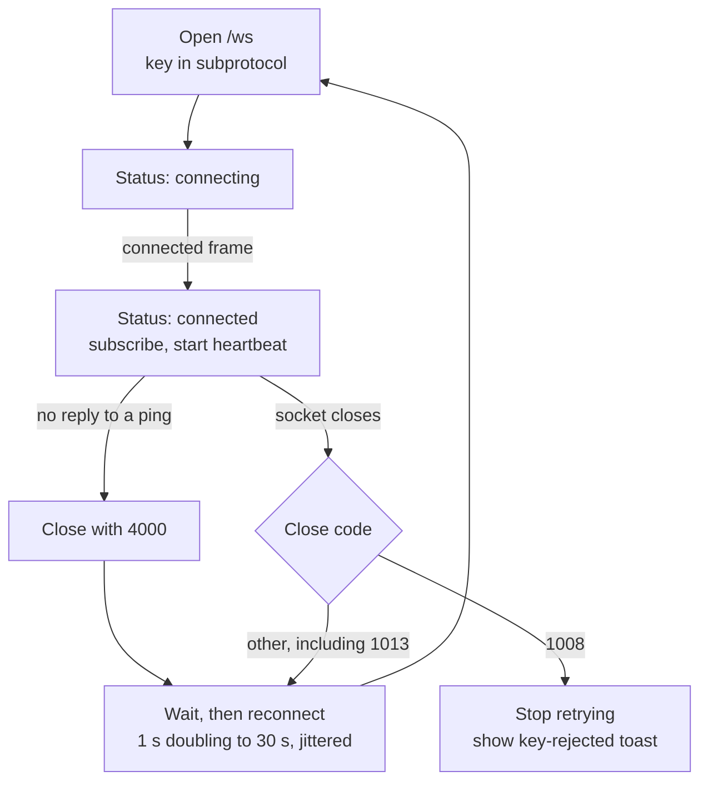

# CodeSage frontend

The React dashboard for CodeSage: pages, commands, configuration, and how it talks to the backend over REST and WebSocket. It is for anyone changing the frontend code. For the project overview and quick start, see the [root README](../README.md).

The stack is React 19, TypeScript, Vite 7, Tailwind CSS, TanStack Query, React Router 7 and Axios.

## Pages

Three routes, all rendered inside a shared layout (header, footer and a connection-status badge). They are defined in `src/App.tsx`. The navigation stays visible on phones, and header rows wrap at narrow widths.

| Route | Page | What you can do |
| --- | --- | --- |
| `/` | `HomePage` | Add a GitHub repository. The field has a fixed `github.com/` prefix; type `owner/repo` or paste a GitHub URL, and it is normalised to `https://github.com/owner/repo` before it is sent. An optional branch field sits below. On success, land on its repository page. |
| `/dashboard` | `DashboardPage` | List all repositories with status and progress. A failed card shows why. Open one with "View Details", delete one, or go to `/` through "Add Repository". There is no reprocess here. |
| `/repository/:id` | `RepositoryPage` | See status, progress and statistics. When the repository is `completed`, search it with suggestions and open hits at the exact line. The source link says "View on GitHub" for github.com and "View source" for any other host. Reprocess or delete it. |

- **Add errors.** The form validates `owner/repo` first ("Enter owner/repo, for example facebook/react"). A pasted `.../tree/<branch>` URL does not pass; use the branch field. Every error from the server appears inline under the repository field, with no redirect and no toast, and the input is kept. Editing the URL clears the error. The text is the server's message, or a fixed one for a timeout ("took too long"), no connection, `401`, `429` and `500` (with the request ID). A `409` adds an "Open it" link to the existing repository. The field is tied to its error with `aria-invalid` and `aria-describedby`. Only success shows a toast.
- **Search.** It has query suggestions and paging (10 hits per page). There is no filter UI. Search is enabled only once the repository is `completed`. For a `failed` repository it says indexing failed and to reprocess; for a `pending` one it shows progress. A failed page change keeps the current results.
- **Reprocess.** It is offered on the repository page for a completed or failed repository. It calls `POST /repositories/{id}/process?force_reprocess=true`.
- **Delete.** Both pages ask for confirmation first. The backend refuses to delete a repository while its job is running.
- **Repository errors.** A `404`, or an id that isn't all digits, shows "not found", even if the repository was cached. Any other load error shows the message with "Try again". A failed background refresh keeps the data it has. Deleting a repository that is already gone counts as deleted.
- **Page not found.** Any other path shows "Page not found" with a link home, inside the layout.
- **Render crashes.** An `ErrorBoundary` around the routes catches them and keeps the navigation up. It is keyed by path, so moving to another page clears it.
- **Dashboard errors.** A load error shows the real message. If a refresh fails, the page says it is showing the last loaded data and retries. `pending` counts as processing.

## Commands

Run these from `frontend/`. From the repo root, `make start-frontend` runs `npm run dev`.

| Command | What it does |
| --- | --- |
| `npm run dev` | Vite dev server on http://localhost:5173 |
| `npm run build` | `tsc -b && vite build`, output in `dist/` |
| `npm run preview` | Serves the built `dist/` locally |
| `npm run lint` | ESLint |
| `npm test` | `vitest run`, one pass, jsdom |

The dev server uses `strictPort`: if port 5173 is taken it exits instead of moving to the next port. The dev server proxies `/api`, `/ws` (with WebSocket upgrade) and `/health` to `127.0.0.1:8001`, so start the backend first (`make start-backend`). The app therefore uses same-origin `/api/v1` and `/ws` in development. In Docker, nginx does the same proxying.

## Configuration

Put these in `frontend/.env.local` for development (see `.env.example`). In Docker they are build arguments; see [deployment/DOCKER.md](../deployment/DOCKER.md).

| Variable | Default | Notes |
| --- | --- | --- |
| `VITE_API_BASE_URL` | `/api/v1` | A trailing slash is dropped, and `/api/v1` is appended if missing, so a bare backend origin works. |
| `VITE_CODESAGE_API_KEY` | unset | Must equal `CODESAGE_API_KEY` in `backend/.env`. Sent as `X-API-Key` and in a WebSocket subprotocol. |
| `VITE_WS_URL` or `VITE_WEBSOCKET_URL` | unset | WebSocket URL. Unset means same-origin `/ws`, using `wss:` on https pages and `ws:` otherwise. `VITE_WS_URL` wins if both are set. |
| `VITE_ENABLE_DEV_TOOLS` | unset | `true` shows the React Query devtools. |

- **The key is public.** Vite inlines `VITE_*` values into the JavaScript bundle, so anyone who can load the app can read the API key. Use this setup for local, single-user work. The prod stack keeps the key in nginx instead; see [Security](../README.md#security) in the root README.
- **Rebuild after changes.** The values are fixed at build time, so restart `npm run dev` or rebuild after editing them.

## Talking to the backend

`src/services/api.ts` exports one `CodeSageAPI` instance on top of Axios, with a 30 s timeout.

- **Base URL.** It comes from `VITE_API_BASE_URL`, as above. Request paths are relative and must not repeat `/api/v1`.
- **API key.** A request interceptor sets `X-API-Key` when `VITE_CODESAGE_API_KEY` is set.
- **401 responses.** A response interceptor calls `notifyAuthError()`. The layout listens for it and shows an "API key rejected" toast. It fires once, then stays quiet until a request succeeds or the WebSocket's `connected` frame arrives, because polling keeps getting `401`.
- **Messages.** `describeError` in `src/lib/errors.ts` turns an error into text: the server's `detail` for most statuses, a fixed line for `401`, `429` and `500`, and the server's own message for `502`, `503` and `504`. A timeout reads "took too long"; no response reads "Cannot reach the CodeSage server".
- **Retries.** TanStack Query does not retry 4xx responses. Other failures retry up to 3 times.
- **Coverage.** It wraps repository CRUD, status and stats, reprocess, search, search suggestions and the MCP tool endpoints under `/ai/mcp`.

## Live updates

`src/services/websocket.ts` holds a single shared `WebSocketService`. `src/hooks/useRealtimeStatus.ts` subscribes pages to it and mirrors each update into the TanStack Query cache.



- **Auth.** Browsers cannot set headers on a WebSocket, so the socket offers two subprotocols: `codesage` and `codesage.key.<hex>`, where `<hex>` is the hex-encoded API key. The key never appears in the URL. With no key set, only `codesage` is offered.
- **Connected status.** An open socket still counts as `connecting`. It becomes `connected`, resets the backoff and subscribes only after the server's `connected` frame. A full server accepts the socket and then closes it with 1013, so that is not a connection.
- **Messages.** The client sends `subscribe` and `unsubscribe` with a `repository_id`, and `ping`. The server sends `repository_status` frames shaped `{type, data}`, plus `connected`, `subscribed`, `unsubscribed`, `pong` and `error`.
- **Heartbeat.** The client pings every 25 s. Any incoming frame counts as proof of life. If a whole interval passes with none, the connection is treated as half-open, closed with code 4000 and reconnected.
- **Backoff.** Reconnect delays start at 1 s and double up to 30 s, scaled by 50-100% jitter. Code 1013 has no special handling: it takes this path like any other close. The attempt counter resets on the next `connected` frame.
- **Close reasons.** The server now sends text with its close codes: 1008 "Invalid or missing API key", 1013 "Too many connections; try again later" and 1011 "Internal error". The client does not show the text; it acts on the code.
- **Code 1008.** The server rejected the key. The client stops retrying, logs a hint to check `VITE_CODESAGE_API_KEY`, and raises the same toast as an HTTP 401.
- **Idle close.** The socket opens only while something is subscribed. One second after the last unsubscribe it closes with 1000. A tab that becomes visible again with subscribers and no socket reconnects at once.
- **Cache updates.** Each `repository_status` frame patches the cached repository, and the repository list, with the new status and file counts. A status change, or a move to `completed` or `failed`, also invalidates the repository, status, stats and list queries, so they refetch.
- **Subscriptions.** The repository page subscribes to its own repository. The dashboard subscribes to the repositories that are `pending` or `processing`.
- **Toasts.** `Layout` runs one global listener (`useStatusToasts.ts`) that shows completion and failure toasts. Toasts sit in a live region, and errors use the alert role. The connection badge also lives in `Layout`. It shows "Live updates unavailable. Retrying…" once a connection with subscribers is lost, and stays up between retries until one succeeds.
- **Polling.** WebSocket frames are not the only source. `src/lib/polling.ts` makes TanStack Query refetch every 3 s (`POLL_INTERVAL_MS`) while a repository is `pending` or `processing`, and stop once it is `completed` or `failed`. The repository, status and stats queries use `pollWhileActive`; the dashboard list uses `pollWhileAnyActive`.

## Layout

```
src/
  App.tsx             routes, providers, optional React Query devtools
  main.tsx            entry point
  pages/              HomePage, DashboardPage, RepositoryPage
  components/
    ErrorBoundary.tsx  catches render crashes
    features/         search-interface, repository-stats
    forms/            github-form (owner/repo and branch validation)
    layout/           Layout (header, footer, global toasts)
    ui/               buttons, cards, toast, status badge, connection badge, dialogs
  services/           api.ts (HTTP client), websocket.ts (live-update client)
  hooks/              useRealtimeStatus, useStatusToasts, usePageTitle
  lib/                polling, queryClient, errors, utils
  types/              repository.ts, mcp.ts (API types)
  test/               setup.ts (vitest setup)
```

## Testing

Tests use vitest with jsdom and Testing Library. The config is in `vite.config.ts` (globals on, CSS off, setup in `src/test/setup.ts`). They sit next to the code as `*.test.ts(x)`.

| Area | Test files |
| --- | --- |
| Pages | `HomePage`, `DashboardPage`, `RepositoryPage` |
| Services | `api` (key header, base URL, 401 handling), `websocket` (welcome-based status, subscriptions, heartbeat, backoff, 1008 and 1013, key subprotocol) |
| Components | `search-interface`, `github-form`, `animated-progress`, `toast`, `ErrorBoundary`, `connection-status`, `delete-confirmation-dialog` |
| Lib | `polling`, `queryClient`, `errors` |

They are unit tests only. Nothing runs against a real backend or browser.
